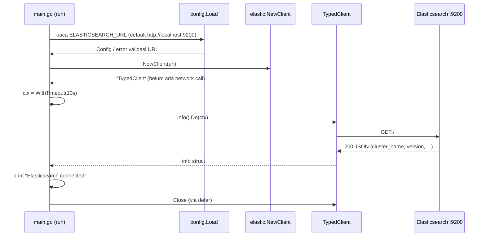

# Learning Guide — go-elasticsearch-poc

Dokumen ini buat dibaca ulang kapan aja tanpa harus buka history chat.
Fokusnya: ngerti **apa yang sudah ada di repo**, **kenapa dibikin begitu**, dan **konsep Elasticsearch yang beneran kepakai** di project ini.

> Status repo saat ini: **Phase 4 (Motorcycle REST API CRUD) SUDAH SELESAI**.
> Aplikasi sudah memiliki REST API lengkap (POST, GET, PUT, DELETE, health check) dengan pemisahan layer Handler → Service → Repository → Elasticsearch.
> Server berjalan via `make run` (`cmd/api`) dan demo Phase 3 tetap dapat dijalankan via `make demo`.
> Seluruh unit test (config, service, handler, elastic) aktif dan lulus 100%. Lihat [ROADMAP.md](ROADMAP.md) untuk detail status dan evidence.

---

## Daftar isi

1. [Objective project](#1-objective-project)
2. [Kenapa Elasticsearch](#2-kenapa-elasticsearch)
3. [Elasticsearch vs MySQL/PostgreSQL](#3-elasticsearch-vs-mysqlpostgresql)
4. [Cluster](#4-cluster)
5. [Node](#5-node)
6. [Index](#6-index)
7. [Document](#7-document)
8. [Shard](#8-shard)
9. [Primary dan replica](#9-primary-dan-replica)
10. [Elasticsearch Go client](#10-elasticsearch-go-client)
11. [Kenapa Go butuh client](#11-kenapa-go-butuh-client)
12. [Typed API](#12-typed-api)
13. [`context.Context`](#13-contextcontext)
14. [`client.Info()`](#14-clientinfo)
15. [Alur koneksi Go → Elasticsearch](#15-alur-koneksi-go--elasticsearch)
16. [Responsibility tiap file](#16-responsibility-tiap-file)
17. [Cara baca dan jalanin source code](#17-cara-baca-dan-jalanin-source-code)
18. [Kalau Elasticsearch nggak tersedia](#18-kalau-elasticsearch-nggak-tersedia)
19. [Pembelajaran Phase 3 — Honda Motorcycle Index & Document](#19-pembelajaran-phase-3--honda-motorcycle-index--document)
20. [Pembelajaran Phase 4 — Motorcycle REST API CRUD](#20-pembelajaran-phase-4--motorcycle-rest-api-crud)
21. [Pembelajaran Phase 5 — Motorcycle Search, Filtering, Sorting & Pagination](#21-pembelajaran-phase-5--motorcycle-search-filtering-sorting--pagination)

---

## 1. Objective project

**Bikin Go API yang pakai Elasticsearch sebagai primary datastore** (untuk POC).

Artinya data aplikasi (nanti: product) disimpan **langsung** ke Elasticsearch sebagai JSON document. Nggak ada MySQL/PostgreSQL di belakangnya.
Target akhirnya: create, read, update, delete, search, dan filtering lewat HTTP API.

Yang **bukan** objective project ini:

- Nyimpen application log ke Elasticsearch.
- Elastic APM, distributed tracing, OpenTelemetry.
- Kibana observability / log aggregation.

> **Waspada:** di `go.mod` lu bakal lihat dependency `go.opentelemetry.io/...` sebagai `// indirect`.
> Itu ketarik otomatis sama library transport-nya Elastic, **bukan** karena kita pakai tracing. Kita nggak nyentuh OpenTelemetry sama sekali.

Target arsitektur nanti:

```text
HTTP Client / Postman → Go API → Handler → Service → Repository → Elasticsearch → JSON Document
```

Yang sudah ada sekarang baru potongan paling bawah: **Go → Elasticsearch** (cek koneksi doang).

---

## 2. Kenapa Elasticsearch

**Pengertian singkat:** Elasticsearch itu search & analytics engine yang nyimpen data dalam bentuk JSON document dan diakses lewat HTTP/REST API. Di dalamnya pakai Apache Lucene.

**Kenapa dipakai di sini:** Koh Franz pengen kita ngerti cara kerja Elasticsearch dari sisi backend Go — gimana nyimpen, ambil, update, hapus, dan nyari data. Kekuatan utama Elastic itu di **full-text search** dan **filtering** yang cepat, dan itu yang mau kita eksplor di Phase 5.

**Contoh di repo:** `compose.yml` jalanin Elasticsearch `9.5.5`, dan `cmd/api/main.go` ngobrol sama dia lewat HTTP di `http://localhost:9200`.

**Hal yang perlu diwaspadai:** Elasticsearch sebagai *primary* datastore itu valid buat POC, tapi ada trade-off yang beda dari database relasional (lihat bagian berikut). Jangan anggap Elastic itu "MySQL versi JSON".

---

## 3. Elasticsearch vs MySQL/PostgreSQL

| Aspek | MySQL / PostgreSQL | Elasticsearch |
|---|---|---|
| Bentuk data | Row di table, kolom fixed | JSON document di index |
| Schema | Wajib didefinisikan (`CREATE TABLE`) | *Mapping*; bisa otomatis (dynamic) atau explicit |
| Query | SQL | Query DSL (JSON) lewat HTTP |
| Join | Kuat | Praktis nggak ada; data biasanya didenormalisasi |
| Transaksi multi-row (ACID) | Ada | **Nggak ada** transaksi lintas document |
| Visibility setelah write | Langsung kelihatan setelah commit | **Near real-time**: search baru lihat data setelah *refresh* (default ±1 detik). GET by `_id` sudah real-time |
| Full-text search | Didukung (via `tsvector`, index GIN, `pg_trgm`), namun tuning relevansi multi-field dan skalabilitas terdistribusinya lebih terbatas | Dirancang khusus sejak awal sebagai search engine terdistribusi (BM25 scoring, field boosting, tokenizers fleksibel) |
| Ubah tipe field yang sudah ada | `ALTER TABLE` | Umumnya harus bikin index baru lalu *reindex* |

**Analogi:** MySQL itu kayak lemari arsip dengan formulir yang kolomnya sudah fix. Elasticsearch itu kayak gudang yang nyimpen dokumen JSON utuh, plus punya katalog super lengkap (*inverted index*) supaya nyari kata di dalam dokumen jadi cepet banget.

**Batas analogi:** "katalog" di Elastic bukan sekadar daftar isi — tiap field diproses sesuai tipe di mapping (misal `text` dipecah jadi kata-kata, `keyword` disimpan utuh). Ini yang nanti bikin perbedaan besar antara search dan filter.

**Waspada buat Phase 3+:**
- Habis insert, kalau langsung *search*, bisa jadi document belum muncul. Itu bukan bug, itu near real-time.
- Jangan ngandelin dynamic mapping buat data serius — Elastic bisa nebak tipe field dengan salah. Makanya Phase 3 pakai **explicit mapping**.
- **Catatan Realistis Performa:** Jangan berasumsi bahwa Elasticsearch pasti lebih cepat daripada PostgreSQL dalam semua skenario. Untuk transaksi ACID OLTP, update saldo, join relasional multi-tabel, atau lookup B-Tree single row via primary key, PostgreSQL justru jauh lebih cepat dan hemat resource. Elasticsearch baru unggul ketika workload melibatkan pencarian teks bebas (full-text search), filtering multi-dimensi dokumen tanpa join, dan analitik/agregasi terdistribusi.

---

## 4. Cluster

**Pengertian singkat:** Cluster = kumpulan satu atau lebih node Elasticsearch yang kerja bareng dan berbagi nama cluster yang sama.

**Kenapa dipakai:** Di production, cluster dipakai buat bagi beban dan tahan kalau ada node yang mati. Buat kita, cluster isinya cuma satu node, tapi konsepnya tetap kepakai (misal *cluster health*).

**Contoh di repo:**
- Nama cluster default dari image Docker: `docker-cluster`. Ini yang dicetak `go run ./cmd/api` di baris `Cluster : ...`.
- `make health` → `GET /_cluster/health` buat lihat status `green` / `yellow` / `red`.

**Waspada:**
- `green` = semua primary dan replica shard ke-assign.
- `yellow` = semua primary aman, tapi ada replica yang nggak bisa ditempatkan. **Di single node ini normal** (lihat [bagian 9](#9-primary-dan-replica)).
- `red` = ada primary shard yang nggak tersedia → itu yang perlu diinvestigasi.

---

## 5. Node

**Pengertian singkat:** Node = satu proses Elasticsearch yang jalan. Satu container ES di Docker = satu node.

**Kenapa dipakai:** Node itu yang beneran nyimpen data dan ngejawab request.

**Contoh di repo:** `compose.yml` pakai `discovery.type=single-node`. Artinya node ini nggak nyari node lain dan langsung jadi cluster sendirian. Di health check lu lihat `"number_of_nodes": 1`.

**Waspada:**
- Node ES itu proses Java (JVM). `ES_JAVA_OPTS=-Xms1g -Xmx1g` set heap 1 GB, tapi total memory container biasanya **lebih dari 1 GB** (ada off-heap, Lucene, OS cache).
- Di Docker Desktop + WSL2, container ini jalan di VM WSL2 yang **sama** dengan distro Ubuntu lu. Jadi ES rebutan RAM sama `next-server`, `gopls`, Node, dll. Ini penting buat ngerti masalah memory di [TROUBLESHOOTING.md](TROUBLESHOOTING.md).

---

## 6. Index

**Pengertian singkat:** Index = wadah logis buat sekumpulan document yang sejenis, lengkap dengan *mapping* (definisi tipe field) dan *settings* (misal jumlah shard).

**Analogi:** Bayangin Elasticsearch itu gudang data. Index itu rak/ruangan buat ngelompokin jenis data (misal rak "products").

**Batas analogi:** Index sering disamain dengan "table" di SQL. Mirip, tapi:
- Index nggak maksa semua document punya field yang sama.
- Begitu tipe sebuah field sudah ditetapkan di mapping, nggak bisa diubah sembarangan.

**Kenapa dipakai:** Semua operasi document (create, get, search) selalu nunjuk ke index tertentu.

**Contoh di repo:** Belum ada index yang dibikin. Tapi `internal/config/config.go` sudah nyiapin `ELASTICSEARCH_INDEX` dengan default `products`. **Variabel ini belum dipakai di mana pun** — reserved buat Phase 3.

**Waspada:**
- Nama index harus lowercase dan nggak boleh mengandung karakter tertentu (misal spasi, `\`, `/`, `*`, `?`, `"`, `<`, `>`, `|`, `,`, `#`).
- Kalau lu index document ke index yang belum ada, by default Elastic **bikin index otomatis** pakai dynamic mapping. Enak buat coba-coba, bahaya buat data serius.

---

## 7. Document

**Pengertian singkat:** Document = satu objek JSON yang disimpan di index. Tiap document punya `_id` unik di dalam index itu.

**Analogi:** Kalau index itu rak, document itu satu item/kardus di rak itu, isinya JSON.

**Contoh (rencana Phase 3, belum ada di repo):**

```json
{
  "name": "Mechanical Keyboard",
  "category": "electronics",
  "price": 750000,
  "created_at": "2026-10-28T10:00:00Z"
}
```

Elastic nyimpen JSON asli lu di field `_source`, dan juga bikin struktur pencarian dari field-field-nya.

**Waspada:**
- Update di Elastic itu sebenarnya **bikin versi baru** dari document (document lama ditandai terhapus). Dari sisi API kelihatannya "update", tapi di dalam itu replace.
- `_id` bisa lu tentuin sendiri atau di-generate Elastic. Keputusan ini nanti dibahas di Phase 3.

---

## 8. Shard

**Pengertian singkat:** Index dipecah jadi satu atau lebih *shard*. Tiap shard sebenarnya satu Lucene index kecil yang mandiri.

**Kenapa dipakai:** Supaya data index bisa dibagi ke beberapa node (scale out) dan diproses paralel.

**Analogi:** Kalau satu rak (index) kebanyakan barang, isinya dibagi ke beberapa kotak (shard) supaya bisa disebar ke beberapa gudang (node).

**Batas analogi:** Jumlah *primary* shard ditentukan saat index dibikin dan nggak bisa diubah gitu aja (perlu split/shrink/reindex).

**Contoh di repo:** Health check sebelumnya nunjukin `"active_primary_shards": 2`. Itu shard dari index internal/sistem Elasticsearch, **bukan** index kita, karena kita belum bikin index apa pun.

**Waspada:** Buat POC single node, 1 primary shard sudah cukup. Jangan nambah shard tanpa alasan.

---

## 9. Primary dan replica

**Pengertian singkat:**
- **Primary shard**: shard utama tempat write pertama kali terjadi.
- **Replica shard**: salinan primary di node **lain**, buat cadangan dan bantu baca.

**Kenapa dipakai:** Kalau satu node mati, replica di node lain bisa naik jadi primary. Data tetap aman.

**Contoh di repo:** Kita cuma punya 1 node. Elastic **nggak pernah** naruh replica di node yang sama dengan primary-nya (percuma, kalau node mati dua-duanya ilang). Jadi:
- Index dengan `number_of_replicas: 1` (default) → replica-nya *unassigned* → cluster **yellow**.
- Waktu cluster masih kosong, status bisa `green` (seperti di health check sebelumnya).

**Waspada:** Di local single node, `yellow` itu **expected**. Nanti di Phase 3 kita bisa set `number_of_replicas: 0` di index POC supaya status tetap `green` — tapi itu keputusan buat local, bukan production.

---

## 10. Elasticsearch Go client

**Pengertian singkat:** Library resmi dari Elastic buat ngobrol sama Elasticsearch dari Go: `github.com/elastic/go-elasticsearch/v9` (di repo kita versi `v9.5.2`).

**Kenapa dipakai:** Official, ngikutin versi Elasticsearch, dan sudah nanganin detail-detail HTTP yang ribet.

**Contoh di repo:** `internal/repository/elastic/client.go` manggil `elasticsearch.NewTyped(elasticsearch.WithAddresses(address))`.

**Waspada:**
- Major version client harus cocok dengan major version server. Server kita `9.5.5`, client `v9.x` → cocok.
- Client ini cuma "alat ngobrol". **Bikin client nggak berarti sudah konek** — lihat [bagian 14](#14-clientinfo).

---

## 11. Kenapa Go butuh client

Elasticsearch itu ngomong HTTP + JSON. Secara teori lu bisa pakai `net/http` doang. Terus kenapa pakai client?

Client nanganin hal yang kalau ditulis sendiri bakal makan waktu dan rawan salah:

- **Connection pool & keep-alive** ke satu atau beberapa node.
- **Retry** untuk error tertentu (misal koneksi gagal, HTTP 502/503/504) — default library maksimal 3 retry.
- **Product check**: client ngecek header response `X-Elastic-Product: Elasticsearch`. Kalau URL lu ternyata nunjuk ke server lain (bukan Elastic), client nolak.
- **Serialize/deserialize JSON** ke struct Go.
- Endpoint & parameter yang sudah ter-generate dari spesifikasi resmi Elastic.

**Contoh di repo:** Kita nggak nulis satu baris `http.NewRequest` pun. Cukup `client.Info().Do(ctx)`.

**Waspada:** Karena client punya retry sendiri, **jangan** bikin retry loop tambahan di atasnya tanpa alasan yang jelas. Yang bikin batas waktunya adalah `context` (bagian 13).

---

## 12. Typed API

**Pengertian singkat:** go-elasticsearch punya dua gaya:

| Gaya | Constructor | Rasanya |
|---|---|---|
| Low-level (`esapi`) | `elasticsearch.New(...)` | Lu kirim body `io.Reader`, terima `*http.Response`, decode JSON sendiri |
| **Typed API** | `elasticsearch.NewTyped(...)` | Request & response berupa struct Go; method chaining; error lebih jelas |

**Kenapa dipakai:** Buat belajar, typed API lebih aman — salah nama field ketahuan saat compile, bukan saat runtime. Response juga langsung jadi struct.

**Contoh di repo:**

```go
info, err := client.Info().Do(ctx)   // info sudah struct, bukan JSON mentah
fmt.Printf("Cluster : %s\n", info.ClusterName)
fmt.Printf("Version : %s\n", info.Version.Int)
```

**Waspada:**
- Nama field struct kadang beda dari JSON-nya karena di-generate otomatis. Contoh nyata: field JSON `version.number` diakses sebagai `info.Version.Int`. Komentar di `main.go` sudah ngejelasin ini — itu contoh komentar "WHY" yang bagus.
- Package typed API itu **gede banget**. Compile pertama kali (atau setelah cache Go kehapus) bisa lama dan makan RAM lumayan. Itu normal.

---

## 13. `context.Context`

**Pengertian singkat:** `context.Context` itu "surat tugas" yang dibawa sebuah operasi: kapan harus berhenti (deadline/timeout) dan apakah sudah dibatalkan.

**Kenapa dipakai:** Operasi network bisa nyangkut. Tanpa batas waktu, program bisa nunggu lama banget kalau server nggak jawab.

**Contoh di repo (`cmd/api/main.go`):**

```go
const connectionTimeout = 10 * time.Second
...
ctx, cancel := context.WithTimeout(context.Background(), connectionTimeout)
defer cancel()

info, err := client.Info().Do(ctx)
```

- `context.Background()` = context kosong, titik awal.
- `WithTimeout(..., 10s)` = turunan yang otomatis "expired" setelah 10 detik.
- `defer cancel()` = bebasin resource timer begitu fungsi selesai, walaupun belum 10 detik. **Selalu** panggil `cancel`.
- Timeout ini membungkus **seluruh** request, termasuk retry yang dilakukan client. Jadi maksimal ±10 detik, bukan 10 detik × jumlah retry.

**Waspada:**
- Kalau muncul `context deadline exceeded`, artinya **nggak ada jawaban dalam 10 detik**. Ini beda dari `connection refused` (ditolak langsung). Jangan buru-buru naikin timeout — cari tahu dulu kenapa server lambat jawab.
- Nanti di HTTP handler (Phase 4), context-nya diambil dari `r.Context()`, bukan `context.Background()`, supaya kalau client HTTP batal, query ke Elastic juga ikut batal.

---

## 14. `client.Info()`

**Pengertian singkat:** `client.Info().Do(ctx)` ngirim `GET /` ke Elasticsearch. Responsenya info dasar cluster: nama node, `cluster_name`, `cluster_uuid`, versi, dan tagline `"You Know, for Search"`.

Sama persis kayak:

```bash
curl http://localhost:9200
```

**Kenapa dipakai:** Ini request paling ringan dan nggak butuh index apa pun. Cocok buat **membuktikan** bahwa Go beneran bisa ngobrol sama Elastic.

**Contoh di repo:** Satu-satunya request ke Elastic di seluruh codebase saat ini ada di `cmd/api/main.go`.

**Waspada:**
- `elasticsearch.NewTyped(...)` **nggak** konek ke server. Dia cuma nyiapin konfigurasi. Komentar di `client.go` sudah bilang: *"It does not contact the cluster"*. Jadi `NewClient` sukses ≠ Elastic hidup. Buktinya cuma dari request beneran kayak `Info()`.
- `Info()` sukses juga belum berarti cluster sehat (bisa aja `red`). Buat kesehatan cluster, pakai `_cluster/health`.

---

## 15. Alur koneksi Go → Elasticsearch

Ini alur yang **beneran ada** di code sekarang:



Kalau ada error di langkah mana pun, `run()` balikin error yang sudah dibungkus konteks, lalu `main()` nge-print `error: ...` dan exit code `1`.

**Pola `main()` → `run()` itu sengaja:** `log.Fatalf` langsung manggil `os.Exit`, dan `os.Exit` **nggak** jalanin `defer`. Dengan naruh logic di `run()`, semua `defer` (cancel context, close client) sudah jalan dulu sebelum `main()` exit. Ini pola idiomatic Go yang layak lu inget.

---

## 16. Responsibility tiap file

| File | Tanggung jawab | Catatan |
|---|---|---|
| `cmd/api/main.go` | Entry point. Load config → bikin client → cek koneksi pakai `Info()` → print hasil → exit | Namanya `api`, tapi **belum** ada HTTP server. Sekarang ini cuma connection check |
| `internal/config/config.go` | Baca env var `ELASTICSEARCH_URL` dan `ELASTICSEARCH_INDEX`, kasih default, validasi URL | Pakai standard library aja, nggak ada dependency tambahan |
| `internal/repository/elastic/client.go` | Bikin `*elasticsearch.TypedClient` dari satu address | Nanti repository product (Phase 3/4) bakal tinggal di package ini |
| `internal/handler/.gitkeep` | Placeholder folder HTTP handler | Kosong |
| `internal/service/.gitkeep` | Placeholder folder business logic | Kosong |
| `internal/model/.gitkeep` | Placeholder folder struct domain (misal `Product`) | Kosong |
| `compose.yml` | Jalanin Elasticsearch 9.5.5 single node, security off (local only), heap 1 GB, volume persisten, healthcheck | Port `9200` saat ini terbuka ke semua interface host |
| `Makefile` | Shortcut: `up`, `down`, `reset`, `logs`, `ps`, `health`, `run`, `tidy` | `make reset` **menghapus data** (volume) |
| `.env.example` | Contoh env var | App **nggak** baca file `.env` otomatis |
| `.gitignore` | Abaikan `.env`, artefak build, folder editor | — |
| `go.mod` / `go.sum` | Definisi module & dependency | Module path: `github.com/fajri-rabka/go-elasticsearch-poc` |

**Kenapa `internal/`?** Di Go, package di bawah `internal/` cuma bisa di-import oleh code di dalam module yang sama. Jadi orang lain nggak bisa (dan nggak perlu) import package kita. Cocok buat aplikasi, bukan library.

**Kenapa client ada di `repository/elastic`?** Karena nanti semua code yang ngobrol langsung ke Elastic dikumpulin di sana. Service dan handler nggak perlu tahu detail Elastic.

---

## 17. Cara baca dan jalanin source code

### Urutan baca yang disarankan

1. `cmd/api/main.go` — mulai dari `main()`, lalu `run()`. Ini peta besarnya.
2. `internal/config/config.go` — gimana URL didapat dan divalidasi.
3. `internal/repository/elastic/client.go` — gimana client dibikin.
4. `compose.yml` — server yang diajak ngobrol.

Kalau mau lihat isi struct dari library (misal field `info.Version`), di editor pakai *Go to Definition*. Atau cek langsung:

```bash
go doc github.com/elastic/go-elasticsearch/v9 NewTyped
```

### Cara jalanin

```bash
# 1. Pastikan Docker Desktop jalan dan `docker` kebaca di WSL
docker compose version

# 2. Nyalain Elasticsearch, tunggu sampai healthy
make up
docker compose ps

# 3. Cek pakai curl dulu (tanpa Go)
curl --max-time 10 http://localhost:9200

# 4. Baru jalanin Go
make run          # sama dengan: go run ./cmd/api
```

Output sukses yang diharapkan:

```text
Elasticsearch connected
Cluster : docker-cluster
Version : 9.5.5
```

Override URL (misal mau coba `127.0.0.1`):

```bash
ELASTICSEARCH_URL=http://127.0.0.1:9200 go run ./cmd/api
```

### Kenapa curl dulu baru Go?

Biar lu bisa misahin masalah. Kalau curl gagal → masalahnya di Docker/Elastic/network, bukan di code Go. Kalau curl sukses tapi Go gagal → baru curigain sisi Go (env var, proxy, resource saat compile/run, dsb).

### Cek kualitas code

```bash
gofmt -l .        # nggak ada output = format rapi
go vet ./...      # static check
go test ./...     # saat ini semua package masih "[no test files]"
```

> **Penting:** `go test ./...` yang "sukses" saat ini **bukan** berarti ada test yang lulus. Semua package masih `[no test files]`. Jadi belum ada test coverage sama sekali.

---

## 18. Kalau Elasticsearch nggak tersedia

Program sengaja **gagal cepat dan jelas**, bukan nunggu selamanya. Ada beberapa skenario:

| Skenario | Error yang kira-kira muncul | Artinya |
|---|---|---|
| Container mati / port nggak ada yang listen | `... connect: connection refused` | Ditolak langsung, biasanya dalam hitungan milidetik |
| Server ada tapi nggak jawab (overload, network nyangkut) | `... context deadline exceeded` | Nunggu 10 detik, nggak ada jawaban |
| `ELASTICSEARCH_URL` diisi kosong | `error: load config: invalid ELASTICSEARCH_URL: must not be empty` | Gagal sebelum ada network call |
| `ELASTICSEARCH_URL` tanpa `http://` | `... must use http or https scheme` | Gagal di validasi config |
| URL nunjuk ke server yang bukan Elasticsearch | Error product check dari client | Client nolak karena header `X-Elastic-Product` nggak ada |

Semua error dicetak sebagai **satu baris** `error: ...` dan exit code `1`. Error-nya dibungkus berlapis (`check elasticsearch connection to <url>: ...`) supaya lu langsung tahu di tahap mana gagalnya dan URL mana yang dipakai.

Contoh output asli dari repo ini ada di [ROADMAP.md](ROADMAP.md) bagian validasi, dan langkah debugging-nya di [TROUBLESHOOTING.md](TROUBLESHOOTING.md).

---

## 19. Pembelajaran Phase 3 — Honda Motorcycle Index & Document

Di Phase 3 ini, kita beneran nyimpen data katalog motor Honda ke Elasticsearch pakai Go. Berikut 12 konsep kunci yang wajib lu kuasai:

### 1. Apa itu index?
- **Pengertian:** Wadah logis di Elasticsearch untuk mengelompokkan document sejenis beserta skema tipe data (*mapping*) dan pengaturannya (*settings*).
- **Contoh di project:** Index `motorcycles` yang dikonfigurasi via `ELASTICSEARCH_INDEX=motorcycles`.
- **Alasan teknis:** Semua pencarian, filter, dan penyimpanan document memerlukan konteks index agar Lucene tahu di inverted index mana data tersebut diindeks.
- **Concern junior:** Nama index harus lowercase, nggak boleh diawali `-`, `_`, `+`, nggak boleh ada spasi atau karakter liar (`\/*?"<>| ,#:`), dan maksimal 255 byte. Di kode kita, `internal/config/config.go` sudah memvalidasi aturan ini di startup.

### 2. Apa bedanya index dengan table SQL?
- **Pengertian:** Table di SQL bersifat relational dengan skema tabular kaku (kolom fixed, `ALTER TABLE`, foreign key, ACID multi-row). Index di Elasticsearch adalah kumpulan document JSON independen berbasis inverted index untuk pencarian teks dan filter agregasi cepat.
- **Contoh di project:** Di SQL kita mungkin bikin tabel `motorcycles` dengan kolom relasi ke tabel `brands`. Di Elasticsearch, objek motor Honda BeAT disimpan denormalized langsung sebagai satu document utuh.
- **Alasan teknis:** Elasticsearch didesain horizontal scale dan distributed search. Nggak ada join tabel di Elastic, sehingga data sengaja didenormalisasi agar tiap document mandiri dan bisa dicari dalam satu kali roundtrip.
- **Concern junior:** Jangan cari transaksi roll-back multi-document atau join di Elasticsearch. Kalau relasi data berubah, lu harus update document-nya secara mandiri.

### 3. Apa itu document dan `_source`?
- **Pengertian:** Document adalah unit data terkecil yang disimpan berupa objek JSON. Field `_source` adalah payload JSON asli yang kita kirimkan saat indexing dan disimpan utuh oleh Elasticsearch.
- **Contoh di project:** Sample motor Honda BeAT kita:
  ```json
  {
    "brand": "Honda",
    "model_name": "BeAT",
    "category": "matic",
    "engine_cc": 110,
    "transmission": "automatic",
    "price_idr": 19000000,
    "available": true,
    "description": "Motor matic Honda untuk mobilitas harian"
  }
  ```
- **Alasan teknis:** Lucene mengindeks kata/token ke struktur internal (inverted index) untuk pencarian cepat, tapi saat kita melakukan `GET` by ID, Elasticsearch mengambil kembali payload utuh dari `_source` untuk diserialisasi balik ke struct Go `model.Motorcycle`.
- **Concern junior:** Kalau lu menonaktifkan `_source` (ada opsinya di Elastic), ukuran storage memang mengecil, tapi lu nggak bakal bisa baca data aslinya lagi lewat GET atau reindex!

### 4. Apa itu `_id`?
- **Pengertian:** Identifier unik untuk sebuah document di dalam satu index.
- **Contoh di project:** `honda-beat-001`.
- **Alasan teknis:** `_id` adalah primary key di level Lucene. Elasticsearch menggunakannya untuk routing shard, mengecek keberadaan dokumen, dan memastikan keunikan. Di struct `model.Motorcycle`, kita **sengaja tidak menaruh field ID** agar tidak ada duplikasi data antara `_id` Elasticsearch dengan isi `_source`.
- **Concern junior:** Jangan duplikasi ID di dalam JSON `_source` kalau nggak ada alasan teknis yang kuat. Kalau disimpan dua kali, rentan terjadi data drift (misal ID di URL beda dengan ID di body).

### 5. Apa itu explicit mapping?
- **Pengertian:** Pendefinisian tipe data tiap field secara eksplisit dan manual sebelum data dimasukkan, bukan membiarkan Elasticsearch menebak sendiri (*dynamic mapping*).
- **Contoh di project:** Di `internal/repository/elastic/motorcycle.go`, fungsi `motorcycleMapping()` mendefinisikan tipe `brand: keyword`, `price_idr: long`, `engine_cc: integer`, dsb., serta mengeset `dynamic: strict`.
- **Alasan teknis:** Dynamic mapping sering salah tebak (misal string tanggal dianggap string biasa, atau angka integer dianggap long). Selain itu, dengan `strict`, jika ada field asing di luar skema, request langsung ditolak sehingga skema index tetap bersih.
- **Concern junior:** Di Elasticsearch, tipe field yang sudah dibuat di mapping **nggak bisa diubah** tanpa bikin index baru lalu reindex. Makanya explicit mapping wajib dipikirkan sejak awal.

### 6. Apa perbedaan `text` dan `keyword`?
- **Pengertian:**
  - `keyword`: Disimpan apa adanya secara utuh (exact match). Tidak dipecah oleh analyzer kata. Cocok untuk filtering, sorting, agregasi, atau ID/kategori.
  - `text`: Dianalisis dan dipecah menjadi token/kata-kata kecil (*tokenized* dan *lowercased*) ke dalam inverted index. Cocok untuk full-text search.
- **Contoh di project:**
  - `category` ("matic") dan `brand` ("Honda") memakai `keyword` karena kita mau filter eksak.
  - `description` ("Motor matic Honda...") memakai `text` agar bisa dicari per kata di Phase 5 nanti.
  - `model_name` ("BeAT") memakai **multi-field**: `text` untuk pencarian full-text dan sub-field `keyword` (`model_name.keyword`) untuk exact match dan sorting.
- **Alasan teknis:** Field `text` tidak bisa dipakai untuk sorting atau terms aggregation secara default karena memorinya sangat boros (*fielddata*). Multi-field memberikan fleksibilitas keduanya.
- **Concern junior:** Kalau lu mau filter kategori motor ("matic"), jangan pakai tipe `text` murni karena pencariannya parsing kata, bukan equality check.

### 7. Kenapa `price_idr` menggunakan `long`?
- **Pengertian:** Di Go kita pakai `int64`, dan di Elasticsearch kita mapping ke tipe `long` (signed 64-bit integer: $-2^{63}$ sampai $2^{63}-1$).
- **Contoh di project:** Harga motor Honda BeAT `19000000` (19 juta rupiah).
- **Alasan teknis:** Tipe `integer` di Elasticsearch hanya 32-bit (maksimal sekitar 2,14 miliar). Walaupun harga motor saat ini masih di bawah 2 miliar, mata uang Rupiah nilainya nominalnya besar. Motor premium, mobil, atau transaksi agregat bisa dengan mudah melampaui limit 32-bit. Menggunakan `long` mencegah integer overflow.
- **Concern junior:** Jangan pakai tipe floating point (`float` atau `double`) untuk mata uang/uang rupiah karena floating point memiliki masalah presisi pembulatan biner. Gunakan integer/long satuan terkecil (Rupiah utuh atau sen).

### 8. Apa yang terjadi ketika Go melakukan indexing?
- **Pengertian:** Saat Go memanggil client untuk insert document:
  1. Struct Go `model.Motorcycle` diserialisasi menjadi JSON.
  2. Client mengirim HTTP request (misal `PUT /motorcycles/_create/honda-beat-001`).
  3. Elasticsearch menerima JSON, memvalidasi terhadap mapping (karena `strict`), menulis ke write-ahead log (*translog*), dan memasukkannya ke in-memory indexing buffer.
- **Contoh di project:** Panggilan `r.client.Create(r.index, id).Document(m).Do(ctx)`.
- **Alasan teknis:** Typed client v9 menangani marshaling JSON, header HTTP, konteks timeout, dan interpretasi HTTP status code dari Elasticsearch secara otomatis.
- **Concern junior:** Indexing memakan resource CPU jika ada text analysis berat. Di skala produksi, batch indexing biasanya dilakukan lewat Bulk API.

### 9. Kenapa GET by ID bisa langsung membaca document?
- **Pengertian:** GET by ID (`GET /motorcycles/_doc/honda-beat-001`) bersifat **real-time**, sedangkan operasi Search bersifat **near-real-time** (NRT).
- **Contoh di project:** Di `cmd/demo/main.go`, tepat setelah `repo.Create()`, kita langsung memanggil `repo.Get()` tanpa jeda atau `time.Sleep()`, dan document langsung berhasil dibaca.
- **Alasan teknis:** GET by ID memeriksa translog (transaction log di memori/disk) jika document tersebut belum sempat di-commit/refresh ke segment Lucene. Sebaliknya, Search query hanya membaca data dari segment Lucene yang sudah di-refresh (secara default per 1 detik).
- **Concern junior:** Jangan berasumsi bahwa setelah document di-insert lu bisa langsung mencarinya via Search query. Untuk Search, ada jeda refresh (~1 detik). Tapi untuk GET by ID, datanya langsung tersedia!

### 10. Apa bedanya create index dan insert document?
- **Pengertian:**
  - Create index: Membuat metadata struktur, alokasi shard, setting replica, dan schema mapping. Dilakukan sekali di awal.
  - Insert document: Menambahkan baris data JSON ke dalam index yang sudah ada. Dilakukan berulang kali sepanjang aplikasi berjalan.
- **Contoh di project:** `repo.EnsureIndex()` menjalankan `r.client.Indices.Create()`, sedangkan `repo.Create()` menjalankan `r.client.Create()`.
- **Alasan teknis:** Memisahkan pembuatan infrastruktur data dari penulisan data aplikasi mencegah index dibuat secara tidak sengaja dengan mapping default yang ngawur.
- **Concern junior:** Jangan satukan logika pembuatan index ke dalam setiap request insert user. Di aplikasi production, inisialisasi index biasanya dijalankan saat startup atau proses migration.

### 11. Kenapa kita perlu idempotency?
- **Pengertian:** Operasi disebut *idempotent* jika dijalankan sekali maupun berkali-kali memberikan efek samping (*side effect*) dan kondisi akhir sistem yang sama.
- **Contoh di project:** Menjalankan `make demo` pertama kali membuat index dan menyimpan Honda BeAT. Menjalankan `make demo` kedua kali tidak membuat index baru, tidak menduplikasi data, tidak menimpa data yang ada, dan tetap sukses membaca data.
- **Alasan teknis:** Di sistem backend riil, request network bisa terputus, retry otomatis bisa terjadi, atau worker aplikasi bisa restart. Jika operasi tidak idempotent, bisa terjadi duplikasi data atau penimpaan data tanpa sengaja.
- **Concern junior:** Hindari operasi `Index()` tanpa ID acak jika ingin idempotent, karena Elastic akan meng-generate ID baru dan menghasilkan duplikat. Gunakan `_id` deterministik dan gunakan API `Create` untuk mencegah overwrite.

### 12. Apa yang terjadi jika document dengan ID sama sudah ada?
- **Pengertian:**
  - Jika menggunakan API `Index` (`PUT /index/_doc/id`): Elasticsearch akan menimpa (*overwrite*) dokumen lama dan menaikkan `_version`.
  - Jika menggunakan API `Create` (`PUT /index/_create/id`): Elasticsearch menolak request dengan status HTTP 409 Conflict dan error `version_conflict_engine_exception`.
- **Contoh di project:** Di `motorcycle.go`, kita sengaja memakai `r.client.Create(r.index, id)`:
  ```go
  if _, err := r.client.Create(r.index, id).Document(m).Do(ctx); err != nil {
      if hasErrorType(err, "version_conflict_engine_exception") {
          return fmt.Errorf("create motorcycle %q: %w", id, ErrAlreadyExists)
      }
      return fmt.Errorf("create motorcycle %q: %w", id, err)
  }
  ```
- **Alasan teknis:** Dengan menangkap conflict exception ini, kita bisa mengetahui dengan pasti bahwa dokumen sudah ada tanpa menimpanya secara diam-diam.
- **Concern junior:** Kalau lu butuh update data, buat fungsi `Update` yang eksplisit, jangan pakai `Index` sembarangan agar data yang lama tidak tertimpa tanpa disadari.

---

## 20. Pembelajaran Phase 4 — Motorcycle REST API CRUD

Di Phase 4, kita membangun HTTP REST API sungguhan di atas Elasticsearch. Arsitekturnya mengikuti prinsip **Separation of Concerns**:
`HTTP Client → Handler → Service → Repository → Elasticsearch`.

Berikut 12 konsep penting Phase 4 yang wajib dipahami junior developer:

### 1. Apa itu REST API?
- **Pengertian:** Gaya arsitektur komunikasi sistem berbasis web yang memanfaatkan protokol HTTP dan method standar (`GET`, `POST`, `PUT`, `DELETE`) untuk memanipulasi resource (dalam hal ini resource: `motorcycles`).
- **Contoh di project:**
  - `POST /motorcycles` untuk menambah motor baru.
  - `GET /motorcycles/{id}` untuk membaca detail motor.
  - `PUT /motorcycles/{id}` untuk mengganti data motor secara utuh.
  - `DELETE /motorcycles/{id}` untuk menghapus motor.
- **Alasan teknis:** Format RESTful memudahkan integrasi dengan frontend, mobile app, maupun client lain (curl, Postman) karena menggunakan standar HTTP yang universal dan stateless.
- **Concern junior:** Jangan bikin endpoint gaya RPC seperti `POST /createMotorcycle` atau `POST /deleteMotorcycleById`. Gunakan kata benda jamak (`/motorcycles`) dan bedakan aksinya lewat HTTP method.

### 2. Apa itu HTTP Handler?
- **Pengertian:** Komponen aplikasi yang bertugas menerima HTTP request, membaca header/path parameter/query/body JSON, memanggil layer service, dan menulis HTTP response (status code & JSON).
- **Contoh di project:** `internal/handler/motorcycle.go` (`MotorcycleHandler`).
- **Alasan teknis:** Handler adalah pintu masuk HTTP. Handler tidak boleh mengurusi query Elasticsearch langsung ataupun aturan validasi domain bisnis yang rumit. Tugasnya hanya menerjemahkan dunia HTTP ke dunia domain Go.
- **Concern junior:** Jangan biarkan handler memuat business logic. Kalau handler lu ratusan baris isinya query dan perhitungan rumus, itu tanda kode mulai bau (*code smell*). Pindahkan ke Service.

### 3. Apa fungsi Service Layer?
- **Pengertian:** Lapisan inti yang mengisolasi business logic dan aturan domain aplikasi dari detail teknis HTTP maupun database.
- **Contoh di project:** `internal/service/motorcycle.go` (`MotorcycleService`).
- **Alasan teknis:** Service memastikan bahwa data motor yang masuk mematuhi aturan: brand harus "Honda", harga harus positif, kapasitas cc harus lebih dari 0, dan ID harus berformat slug yang rapi. Service tidak peduli apakah data itu datang dari HTTP JSON, gRPC, atau CLI.
- **Concern junior:** Jangan buat service yang cuma jadi "penerus kosong" (*pass-through*) kalau nggak ada logic. Tapi begitu ada validasi bisnis, taruh di Service agar bisa di-unit test secara independen tanpa perlu HTTP server.

### 4. Apa fungsi Repository?
- **Pengertian:** Lapisan abstraksi penyimpanan data. Mengisolasi cara data disimpan, diambil, dan diubah di datastore.
- **Contoh di project:** `internal/repository/elastic/motorcycle.go` (`MotorcycleRepository`).
- **Alasan teknis:** Semua sintaks spesifik Elasticsearch (Typed API `r.client.Index`, `r.client.Get`, `r.client.Delete`, mapping, optimistic concurrency `IfSeqNo`) terkonsentrasi di sini. Jika di masa depan library atau konfigurasi Elasticsearch berubah, layer Service dan Handler tidak perlu dirombak.
- **Concern junior:** Repository tidak boleh mengurusi HTTP status code (misal menulis 404). Repository hanya mengembalikan domain error (`ErrNotFound`, `ErrConflict`, `ErrAlreadyExists`), lalu Handler yang menerjemahkannya ke HTTP status.

### 5. Apa bedanya POST dan PUT?
- **Pengertian:**
  - `POST /motorcycles`: Membuat resource baru. Tidak idempotent jika tanpa proteksi ID unik. Di project kita, jika ID sudah ada, POST mengembalikan HTTP 409 Conflict.
  - `PUT /motorcycles/{id}`: Mengganti resource yang sudah ada secara **penuh (full replacement)**. Bersifat idempotent: jika dikirim ulang dengan payload yang sama, kondisi akhir resource tetap sama.
- **Contoh di project:**
  - POST menyertakan transport field `id` di body JSON untuk create motor baru: `honda-scoopy-api-001`.
  - PUT membaca `id` dari path URL dan mengganti seluruh isi field motor tersebut dengan data baru.
- **Alasan teknis:** Di Elasticsearch, operasi Index standar (`PUT /index/_doc/id`) secara default bertindak sebagai *upsert* (kalau belum ada dibuatkan baru). Di REST API kita, kita **tidak ingin PUT melakukan upsert diam-diam**, sehingga kita memeriksa keberadaan dokumen terlebih dahulu.
- **Concern junior:** Jangan gunakan PUT untuk "partial update" (cuma update 1-2 field). Kalau mau partial update, di REST standar itu tugasnya `PATCH`. PUT mengharuskan client mengirimkan seluruh field secara lengkap.
- **Catatan Standar HTTP (RFC 9110):** Standar HTTP sebenarnya memperbolehkan PUT membuat resource baru jika target URI belum ada (*create or replace*). Namun di API katalog kita, kita sengaja menerapkan *domain policy* ketat: PUT hanya untuk *full replacement* data yang sudah ada (kembalikan 404 jika ID belum terdaftar). Tujuannya agar pembuatan dokumen baru selalu terkontrol lewat POST dengan validasi ID slug yang ketat.

### 6. Apa itu CRUD?
- **Pengertian:** Akronim dari Create, Read, Update, Delete — empat operasi dasar manipulasi data pada penyimpanan persistent.
- **Contoh di project:**
  - **C**reate: `POST /motorcycles`
  - **R**ead: `GET /motorcycles/{id}`
  - **U**pdate: `PUT /motorcycles/{id}`
  - **D**elete: `DELETE /motorcycles/{id}`
- **Alasan teknis:** CRUD adalah fondasi sebelum kita masuk ke fitur yang lebih kompleks seperti search, filter, facet, dan aggregations di Phase 5.
- **Concern junior:** CRUD di Elasticsearch punya karakteristik khusus dibanding RDBMS: ada konsep *near-real-time* untuk search, namun GET by ID selalu bersifat real-time.

### 7. Kenapa ID tidak disimpan dua kali?
- **Pengertian:** Document ID Elasticsearch (`_id`) adalah primary key. Di dalam payload JSON asli (`_source`), kita tidak menyertakan field `"id": "..."`.
- **Contoh di project:**
  - Struct `model.Motorcycle` tidak punya field `ID`.
  - Saat client melakukan `POST /motorcycles`, field `id` di JSON body diambil oleh Handler untuk dijadikan path parameter `_id` Elasticsearch, sementara payload yang di-index hanya struct `Motorcycle`.
  - Saat client melakukan `GET /motorcycles/{id}`, response DTO menggabungkan kembali `_id` dengan data `Motorcycle`.
- **Alasan teknis:** Menyimpan ID di dalam `_source` dan di `_id` menyebabkan duplikasi data yang rentan terhadap *data drift* (misal ID di URL diubah tapi isi dokumen tidak sinkron).
- **Concern junior:** Jangan tergoda menambahkan tag `json:"id"` di domain model jika database lu sudah mengelola ID di level metadata dokumen.

### 8. Kenapa perlu Validation di dua level?
- **Pengertian:**
  - **Format HTTP Validation (Handler):** Validasi sintaks JSON, body size limit (1 MiB), unknown fields rejection (`DisallowUnknownFields()`), dan kelengkapan field wajib (apakah field `available` ada nilainya atau nil).
  - **Domain Business Validation (Service):** Validasi logika aturan bisnis (apakah brand adalah "Honda", apakah cc > 0, apakah harga > 0, apakah format slug ID valid).
- **Contoh di project:**
  - Jika client mengirim payload `{"brand": "Honda", "extra_prop": 123}`, ditolak oleh Handler (400 Bad Request: unknown field).
  - Jika client mengirim `{"id": "scoopy-001", "brand": "Yamaha", ...}`, ditolak oleh Service (400 Bad Request: brand must be "Honda").
- **Alasan teknis:** Menjaga sistem tetap aman (*defense in depth*) dan memberikan pesan error yang jelas dan spesifik kepada pengguna API sebelum query dikirim ke datastore.
- **Concern junior:** Khusus tipe boolean seperti `available: false`, jika di Go didefinisikan sebagai `bool` biasa (bukan pointer `*bool`), JSON decoder akan mengisinya dengan default `false` jika field tidak dikirim. Menggunakan pointer `*bool` pada DTO request memungkinkan kita membedakan antara "field tidak dikirim" vs "field bernilai false".

### 9. Kenapa HTTP 404 dan 409 berbeda?
- **Pengertian:**
  - `404 Not Found`: Target resource yang diminta tidak ada di sistem.
  - `409 Conflict`: Request tidak bisa diproses karena terjadi benturan status pada resource (misal ID sudah ada pada Create, atau versi dokumen sudah berubah saat concurrent Update).
- **Contoh di project:**
  - Memanggil `GET /motorcycles/honda-ghost-999` menghasilkan **404**.
  - Memanggil `POST /motorcycles` dengan ID yang sudah ada (`honda-beat-001`) menghasilkan **409 Conflict** (`motorcycle already exists`).
  - Memanggil `PUT /motorcycles/{id}` saat ada proses lain yang mendahului update menghasilkan **409 Conflict** (`document version conflict`).
- **Alasan teknis:** Status code yang presisi mempermudah client API (frontend/mobile) menentukan tindakan: apakah harus menampilkan halaman "Data Tidak Ditemukan" (404) atau memberi notifikasi "Data Sudah Ada / Terjadi Benturan" (409).
- **Concern junior:** Jangan memukul rata semua error menjadi 400 Bad Request atau 500 Internal Server Error.

### 10. Apa itu Optimistic Concurrency Control?
- **Pengertian:** Pola penanganan modifikasi data bersamaan tanpa melakukan penguncian (*locking*) tabel/dokumen. Sistem mengecek apakah dokumen telah berubah sejak terakhir kali dibaca sebelum menyimpan perubahan baru.
- **Contoh di project:**
  Saat `PUT /motorcycles/{id}` dipanggil:
  1. Service membaca dokumen via GET dan memperoleh metadata `_seq_no` dan `_primary_term`.
  2. Saat menulis update via Typed API Index, kita sertakan parameter:
     ```go
     r.client.Index(r.index).
         Id(id).
         IfSeqNo(strconv.FormatInt(*getRes.SeqNo_, 10)).
         IfPrimaryTerm(strconv.FormatInt(*getRes.PrimaryTerm_, 10)).
         Document(m)
     ```
  3. Jika ada request concurrent lain yang mengubah dokumen tersebut di antara langkah 1 dan 2, `_seq_no` di Elasticsearch akan naik, dan request kita otomatis ditolak dengan `version_conflict_engine_exception` -> kita petakan ke HTTP 409 Conflict!
- **Alasan teknis:** Elasticsearch didesain terdistribusi dan non-blocking. Optimistic locking berbasis Sequence Number dan Primary Term adalah standar resmi Elasticsearch untuk mencegah *lost updates*.
- **Concern junior:** Jangan mematikan pengecekan ini di production. Kalau dimatikan, dua user yang mengedit motor bersamaan akan saling menimpa data tanpa peringatan.

### 11. Bagaimana Request Context diteruskan ke Elasticsearch?
- **Pengertian:** Mengalirkan `r.Context()` dari HTTP request handler ke Service, lalu ke method Typed Client `.Do(ctx)`.
- **Contoh di project:**
  ```go
  // Di Handler:
  h.svc.Get(r.Context(), id)

  // Di Repository:
  r.client.Get(r.index, id).Do(ctx)
  ```
- **Alasan teknis:** Jika client HTTP menutup browser, memutus koneksi Postman, atau timeout terjadi di level web server, context akan otomatis di-cancel (`ctx.Done()`). Elasticsearch client yang mendengarkan context tersebut akan segera membatalkan query dan membebaskan koneksi TCP/socket, mencegah pemborosan resource backend.
- **Concern junior:** Jangan pernah membuat `context.Background()` baru di dalam handler untuk query database! Selalu teruskan `r.Context()`.
- **Catatan Server-side Elasticsearch:** Perlu dipahami bahwa context cancellation langsung memutus koneksi di sisi client Go. Namun di sisi server Elasticsearch, proses Lucene yang sudah terlanjur berjalan di level shard tidak selalu langsung berhenti seketika di memori, melainkan akan berhenti pada checkpoint pemeriksaan I/O berikutnya atau saat eksekusi task selesai.

### 12. Cara Pengujian dengan Postman atau curl

Berikut contoh nyata perintah `curl` untuk menguji API kita:

```bash
# 1. Health check
curl -i http://127.0.0.1:8080/health

# 2. Create motorcycle baru (POST)
curl -i -X POST http://127.0.0.1:8080/motorcycles \
  -H "Content-Type: application/json" \
  -d '{
    "id": "honda-scoopy-api-001",
    "brand": "Honda",
    "model_name": "Scoopy",
    "category": "matic",
    "engine_cc": 110,
    "transmission": "automatic",
    "price_idr": 22000000,
    "available": true,
    "description": "Motor matic Honda untuk kebutuhan harian"
  }'

# 3. Read motorcycle (GET)
curl -i http://127.0.0.1:8080/motorcycles/honda-scoopy-api-001

# 4. Update motorcycle full replacement (PUT)
curl -i -X PUT http://127.0.0.1:8080/motorcycles/honda-scoopy-api-001 \
  -H "Content-Type: application/json" \
  -d '{
    "brand": "Honda",
    "model_name": "Scoopy Prestige",
    "category": "matic",
    "engine_cc": 110,
    "transmission": "automatic",
    "price_idr": 23500000,
    "available": true,
    "description": "Motor matic Honda edisi Prestige"
  }'

# 5. Delete motorcycle (DELETE)
curl -i -X DELETE http://127.0.0.1:8080/motorcycles/honda-scoopy-api-001
```

---

## 21. Pembelajaran Phase 5 — Motorcycle Search, Filtering, Sorting & Pagination

Di Phase 5, kita melangkah ke kekuatan sejati Elasticsearch: kemampuan pencarian canggih (*advanced search*), filtering terstruktur, multi-field sorting, dan pagination yang efisien. Kita membangun endpoint `GET /motorcycles` yang fleksibel namun tetap terlindungi dari crash performa.

Berikut 16 konsep fundamental Phase 5 yang wajib lu kuasai sebagai backend engineer Go:

### 1. Apa itu Search API di Elasticsearch dan bedanya dengan GET by ID?
- **Real-time vs Near-Real-Time (NRT):**
  - **GET by ID (`GET /index/_doc/id`):** Bersifat **real-time**. Operasi ini membaca langsung dari translog (*transaction log*) atau segment memori Lucene terbaru. Begitu dokumen berhasil di-insert atau di-update, detik itu juga dokumen bisa langsung dibaca lewat ID-nya.
  - **Search API (`POST /index/_search`):** Bersifat **Near-Real-Time (NRT)**. Search mengeksekusi inverted index pada segment Lucene yang sudah di-*refresh*. Secara default, Elasticsearch melakukan refresh berkala setiap 1 detik (`refresh_interval: "1s"`). Artinya, ada jeda hingga ~1 detik antara saat dokumen ditulis sampai dokumen tersebut muncul di hasil pencarian.
- **Kapan ini terasa?** Saat lu melakukan integrasi otomatis: insert dokumen lalu langsung search dalam rentang beberapa milidetik, dokumen baru bisa jadi belum muncul kecuali index di-refresh (`POST /motorcycles/_refresh`).
- **Alasan teknis:** Melakukan refresh setiap ada write itu mahal secara I/O dan CPU karena harus membuat segment Lucene baru. Oleh karena itu, Elasticsearch menumpuk perubahan di in-memory buffer sebelum di-refresh secara berkala.

### 2. Apa itu Query Context vs Filter Context? Kapan pakai `must` vs `filter`?
- **Query Context (`must` / `should`):**
  - Menjawab pertanyaan: *"Seberapa cocok dokumen ini dengan query pencarian?"*
  - Menghitung **relevance score (`_score`)**. Semakin cocok kata kuncinya, semakin tinggi skor dokumen.
  - Contoh: Pencarian teks bebas (full-text search) seperti kata kunci `"BeAT"` atau `"motor harian"`.
  - Tidak di-cache secara otomatis oleh Elasticsearch.
- **Filter Context (`filter` / `must_not`):**
  - Menjawab pertanyaan biner sederhana: *"Apakah dokumen ini memenuhi syarat? Ya atau Tidak?"*
  - **TIDAK menghitung score** (`_score` tidak terpengaruh).
  - Filter yang sering dipanggil (*frequently used filters*) pada segment yang cukup besar (>= 10.000 dokumen atau >= 3% index) otomatis di-cache dalam memory (*node query cache*) oleh Elasticsearch menggunakan bitset, sehingga eksekusi filter berikutnya sangat cepat. Tidak semua filter pada segment kecil selalu langsung di-cache.
  - Contoh: Filter status `available == true`, filter kategori `category == "matic"`, atau rentang harga `min_price <= price_idr <= max_price`.
- **Golden Rule:** Jika lu butuh pencarian teks relevansi, taruh di Query Context (`must`). Jika lu butuh filter data kaku (kategori, status, range harga/tanggal), **selalu taruh di Filter Context (`filter`)**.

### 3. Apa itu `bool` Query dan bagaimana strukturnya?
- `bool` query adalah query gabungan (*compound query*) di Elasticsearch yang bertindak seperti operator logika boolean di SQL (`AND`, `OR`, `NOT`):
  1. `must`: Harus cocok (seperti `AND`). Berkontribusi ke perhitungan `_score` (Query Context).
  2. `filter`: Harus cocok (seperti `AND`). **TIDAK** berkontribusi ke `_score` (Filter Context). Hasilnya memenuhi syarat untuk di-cache (*cache-eligible*) oleh bitset node query cache.
  3. `should`: Boleh cocok (seperti `OR`). Jika berada di Query Context, mencocokkan lebih banyak clause akan menaikkan `_score`.
  4. `must_not`: Tidak boleh cocok (seperti `NOT` / `!=`). Berada di Filter Context (tidak berpengaruh ke score).
- **Di codebase kita:**
  Jika ada parameter `search`, kita masukkan `multi_match` ke dalam `bool.must`.
  Semua filter (`category`, `transmission`, `available`, `price_idr`) kita masukkan ke dalam `bool.filter`.
  Jika tidak ada search dan tidak ada filter sama sekali, kita gunakan `match_all` query.

### 4. Apa itu `multi_match` Query?
- `multi_match` memungkinkan kita mencari kata kunci yang sama ke dalam beberapa text fields sekaligus dalam satu query.
- Contoh di project kita:
  ```go
  esdsl.NewMultiMatchQuery(search).Fields("model_name^2", "description")
  ```
- Alih-alih membuat beberapa `match` query manual yang di-OR-kan, `multi_match` mengevaluasi kata kunci di field `model_name` dan `description` sekaligus, lalu menggabungkan skor relevansinya sesuai tipe kecocokan (default: `best_fields`).

### 5. Apa itu Field Boosting (contoh: `model_name^2`)?
- **Pengertian:** Teknik memberi bobot relevansi lebih tinggi pada field tertentu. Sintaks `model_name^2` berarti skor kecocokan pada field `model_name` diberi pengali bobot relatif (*relevance weight*) sebesar **2 kali lipat** dibanding kecocokan pada `description`.
- **Kenapa penting?** Jika seorang pembeli mencari kata `"BeAT"`, dokumen yang mencantumkan nama model `"BeAT"` umumnya akan memiliki skor relevansi lebih tinggi daripada motor lain yang kebetulan hanya menyebutkan kata "beat" di dalam paragraf deskripsinya.
- **Catatan Realistis:** Boosting menaikkan prioritas skor relatif, namun **tidak menjamin secara mutlak** bahwa dokumen pasti selalu berada di ranking 1 pada semua skenario. Algoritma BM25 tetap memperhitungkan faktor lain seperti frekuensi kemunculan kata (Term Frequency), keunikan kata (Inverse Document Frequency), dan panjang teks field (Field Length Normalization).

### 6. Apa itu `term` Query dan kenapa untuk exact match?
- `term` query mencari nilai yang **persis sama (exact match)** di dalam inverted index tanpa melakukan analisis atau pemecahan token pada nilai pencarian.
- Pencarian term pada kamus index (*inverted index dictionary / FST*) sangat efisien karena langsung mencari term yang cocok tanpa memproses tokenizer/analyzer.
- Oleh karena itu, `term` query harus dipasangkan dengan field yang **tidak di-tokenize**, yaitu field bertipe `keyword` (seperti `category`, `transmission`) atau tipe `boolean` (`available`).
- **Peringatan junior:** Jangan gunakan `term` query pada field bertipe `text` standar! Karena field `text` di-tokenize menjadi huruf kecil per kata oleh standard analyzer, query `term` yang mencari kalimat utuh atau huruf besar akan gagal menemukan dokumen.

### 7. Apa itu `range` Query pada harga (`price_idr`)?
- `range` query mencocokkan dokumen yang memiliki nilai numerik, tanggal, atau IP di dalam rentang tertentu.
- Operator yang didukung:
  - `gte`: Greater than or equal (>=)
  - `gt`: Greater than (>)
  - `lte`: Less than or equal (<=)
  - `lt`: Less than (<)
- Di project kita, kita menggunakan `esdsl.NewNumberRangeQuery("price_idr")` di dalam `bool.filter`. Jika client mengirim `min_price=15000000`, kita set `.Gte(...)`. Jika mengirim `max_price=25000000`, kita set `.Lte(...)`. Karena berada di Filter Context, operasi range ini tidak membebani komputasi score dan memenuhi syarat query cache.

### 8. Bagaimana Sorting bekerja di Elasticsearch?
- Secara default, jika tidak ada sort yang ditentukan dan ada query pencarian, Elasticsearch akan mengurutkan dokumen berdasarkan skor relevansi: `_score` descending (dokumen paling cocok di paling atas).
- Jika user meminta pengurutan harga (`price_asc` atau `price_desc`), Elasticsearch mengabaikan `_score` dan menyortir dokumen berdasarkan nilai kolom menggunakan struktur data columnar bernama **doc_values**.
- Di project kita:
  - Jika ada `search` tapi tanpa sort -> default `relevance` (`_score` desc).
  - Jika tidak ada `search` -> default `name_asc` (`model_name.keyword` asc).
  - User juga bisa memilih `price_asc`, `price_desc`, atau `name_desc`.

### 9. Kenapa sort pada `model_name.keyword` bukan pada `model_name`?
- **Text field vs Keyword sub-field:**
  - Field `model_name` bertipe `text`. Tipe `text` dipecah menjadi token-token kata (misal: "CB150R Streetfire" dipecah jadi `cb150r` dan `streetfire`). Mengurutkan teks yang terpecah butuh struktur in-memory mahal bernama `fielddata` yang secara default dimatikan di Elasticsearch karena bisa menghabiskan RAM (*Out of Memory*).
  - Untungnya, pada explicit mapping kita definisikan sub-field multifield:
    ```json
    "model_name": {
      "type": "text",
      "fields": {
        "keyword": { "type": "keyword", "ignore_above": 256 }
      }
    }
    ```
  - Sub-field `model_name.keyword` menyimpan string asli secara utuh tanpa tokenisasi di dalam **doc_values** (struktur disk columnar yang hemat RAM).
  - Oleh karena itu, kita selalu melakukan sorting pada `model_name.keyword`!

### 10. Bagaimana Pagination dengan `from` dan `size`?
- `from`: Offset dokumen yang dilewati (0-indexed). Rumusnya: `(page - 1) * limit`.
- `size`: Jumlah dokumen yang dikembalikan per halaman (`limit`).
- Contoh: Halaman 1 dengan limit 10 -> `from = 0`, `size = 10`. Halaman 2 dengan limit 10 -> `from = 10`, `size = 10`.
- Ini adalah metode pagination paling sederhana dan umum untuk web catalog.

### 11. Apa itu `max_result_window` dan kenapa harus diproteksi di Go?
- Di Elasticsearch, setting `index.max_result_window` memiliki nilai default **10,000**.
- **Bahaya Deep Pagination:** Jika client meminta `page=10001&limit=10`, nilai `from + size = 100,010`. Untuk mengembalikan 10 dokumen di halaman itu, setiap shard harus mengurutkan dan menampung 100,010 dokumen di memori sebelum membuang 100,000 pertama! Ini bisa membuat cluster OOM dan crash.
- Jika query melebihi 10,000, Elasticsearch akan mengembalikan error 500 `Result window is too large`.
- **Solusi Engineering:** Service Go kita secara proaktif memeriksa `from + limit <= 10000`. Jika melebihi batas, kita langsung tolak di layer aplikasi dengan HTTP 400 Bad Request: `"page offset and limit exceed maximum result window of 10000"`. Jangan biarkan request berbahaya sampai membebani cluster database.

### 12. Apa itu `track_total_hits`?
- Secara default, untuk optimasi kecepatan pada dataset jutaan dokumen, Elasticsearch membatasi penghitungan total hits hanya sampai 10,000 (`hits.total.relation = "gte"`).
- Dengan mengaktifkan `TrackTotalHits(esdsl.NewTrackHits().Bool(true))`, Elasticsearch dipaksa menghitung jumlah dokumen yang cocok secara akurat (`hits.total.relation = "eq"`).
- Ini penting agar UI frontend bisa menghitung `total_pages` dengan tepat (`ceil(total / limit)`).

### 13. Cara kerja Typed API & `esdsl` di `go-elasticsearch/v9`
- Official client v9 menyediakan DSL builder type-safe di package `github.com/elastic/go-elasticsearch/v9/typedapi/esdsl`.
- Builder functions seperti `esdsl.NewBoolQuery()`, `esdsl.NewMultiMatchQuery()`, `esdsl.NewTermQuery()`, dan `esdsl.NewNumberRangeQuery()` mengembalikan antarmuka `types.QueryVariant`.
- Hal ini mencegah kesalahan penulisan string JSON mentah (*typo*) saat runtime dan memberikan autocompletion serta compile-time safety.
- **Catatan Teknis Unit Test:** Builder wrapper struct di `esdsl` memiliki unexported fields. Untuk melakukan serialisasi JSON pada unit test query builder, kita memanggil method `.QueryCaster()` atau `.SortCombinationsCaster()`.

### 14. Struktur Response Search Elasticsearch & Cara Decode di Go
- Struktur response search:
  ```json
  {
    "hits": {
      "total": { "value": 1, "relation": "eq" },
      "hits": [
        {
          "_index": "motorcycles",
          "_id": "honda-beat-001",
          "_score": 1.25,
          "_source": {
            "brand": "Honda",
            "model_name": "BeAT", ...
          }
        }
      ]
    }
  }
  ```
- Di Go:
  - Total dokumen dibaca dari `res.Hits.Total.Value`.
  - Tiap hit di-loop dari `res.Hits.Hits`.
  - Identifier dokumen diambil dari `*hit.Id_`.
  - Data payload didecode via `json.Unmarshal(hit.Source_, &m)`.
  - Keduanya digabung ke struct `model.MotorcycleWithID{ ID: id, Motorcycle: m }`.

### 15. Kenapa Response List JSON harus `[]` bukan `null`?
- Jika slice Go dideklarasikan tanpa inisialisasi (`var items []MotorcycleWithID`), Go menyimpannya sebagai `nil`.
- Jika slice bernilai `nil` di-marshal dengan `json.Marshal`, hasilnya adalah `"data": null`.
- Bagi frontend developer (JavaScript, React, Flutter, Android, iOS), menerima `null` untuk field daftar/array sering kali memicu error runtime legendaris: `Cannot read properties of null (reading 'map')` atau `NullPointerException`.
- Dengan menginisialisasi slice kosong: `make([]model.MotorcycleWithID, 0, len(...))`, JSON serializer selalu menghasilkan `"data": []`. Ini adalah standar API profesional yang ramah frontend.

### 16. Cara Go 1.22+ `net/http` membedakan Rute tanpa Collision
- Sebelum Go 1.22, mendaftarkan `/motorcycles` dan `/motorcycles/{id}` sering kali bentrok atau butuh router pihak ketiga seperti Gorilla Mux atau Chi.
- Di Go 1.22+, standard library `net/http.ServeMux` mendukung routing berbasis method dan path pattern:
  - `GET /motorcycles`: Pola pasti (*exact pattern* tanpa trailing slash). Hanya menangkap request yang tepat ke path `/motorcycles`.
  - `GET /motorcycles/{id}`: Pola dengan path parameter `{id}`. Menangkap request dengan satu segmen tambahan setelah `/motorcycles/` (seperti `/motorcycles/honda-beat-001`).
- Keduanya tidak bentrok (*no route collision*), bersih, dan sepenuhnya menggunakan Go standard library tanpa dependensi framework external.


