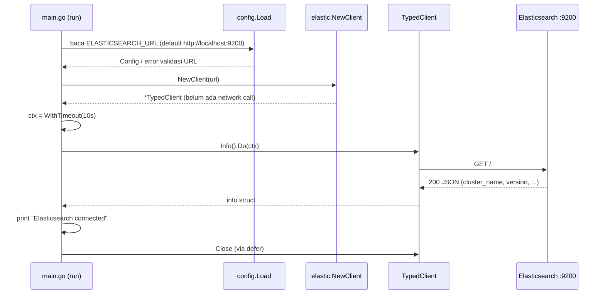

# Learning Guide — go-elasticsearch-poc

Dokumen ini buat dibaca ulang kapan aja tanpa harus buka history chat.
Fokusnya: ngerti **apa yang sudah ada di repo**, **kenapa dibikin begitu**, dan **konsep Elasticsearch yang beneran kepakai** di project ini.

> Status repo saat ini: **Phase 3 (Index & Document) SUDAH SELESAI**.
> Kita sudah punya index `motorcycles` dengan explicit mapping strict, model data `Motorcycle`, dan sample document Honda BeAT (`honda-beat-001`).
> Unit test sudah aktif dan lulus. Lihat [ROADMAP.md](ROADMAP.md) untuk detail status dan evidence.

---

## Daftar isi

1. [Objective project](#1-objective-project)
2. [Kenapa Elasticsearch](#2-kenapa-elasticsearch)
3. [Elasticsearch vs MySQL/PostgreSQL](#3-elasticsearch-vs-mysqlpostgresql)
4. [Cluster](#4-cluster)
5. [Node](#5-node)
6. [Index](#6-index)
7. [Document](#7-document)
8. [Shard](#8-shard)
9. [Primary dan replica](#9-primary-dan-replica)
10. [Elasticsearch Go client](#10-elasticsearch-go-client)
11. [Kenapa Go butuh client](#11-kenapa-go-butuh-client)
12. [Typed API](#12-typed-api)
13. [`context.Context`](#13-contextcontext)
14. [`client.Info()`](#14-clientinfo)
15. [Alur koneksi Go → Elasticsearch](#15-alur-koneksi-go--elasticsearch)
16. [Responsibility tiap file](#16-responsibility-tiap-file)
17. [Cara baca dan jalanin source code](#17-cara-baca-dan-jalanin-source-code)
18. [Kalau Elasticsearch nggak tersedia](#18-kalau-elasticsearch-nggak-tersedia)

---

## 1. Objective project

**Bikin Go API yang pakai Elasticsearch sebagai primary datastore** (untuk POC).

Artinya data aplikasi (nanti: product) disimpan **langsung** ke Elasticsearch sebagai JSON document. Nggak ada MySQL/PostgreSQL di belakangnya.
Target akhirnya: create, read, update, delete, search, dan filtering lewat HTTP API.

Yang **bukan** objective project ini:

- Nyimpen application log ke Elasticsearch.
- Elastic APM, distributed tracing, OpenTelemetry.
- Kibana observability / log aggregation.

> **Waspada:** di `go.mod` lu bakal lihat dependency `go.opentelemetry.io/...` sebagai `// indirect`.
> Itu ketarik otomatis sama library transport-nya Elastic, **bukan** karena kita pakai tracing. Kita nggak nyentuh OpenTelemetry sama sekali.

Target arsitektur nanti:

```text
HTTP Client / Postman → Go API → Handler → Service → Repository → Elasticsearch → JSON Document
```

Yang sudah ada sekarang baru potongan paling bawah: **Go → Elasticsearch** (cek koneksi doang).

---

## 2. Kenapa Elasticsearch

**Pengertian singkat:** Elasticsearch itu search & analytics engine yang nyimpen data dalam bentuk JSON document dan diakses lewat HTTP/REST API. Di dalamnya pakai Apache Lucene.

**Kenapa dipakai di sini:** Koh Franz pengen kita ngerti cara kerja Elasticsearch dari sisi backend Go — gimana nyimpen, ambil, update, hapus, dan nyari data. Kekuatan utama Elastic itu di **full-text search** dan **filtering** yang cepat, dan itu yang mau kita eksplor di Phase 5.

**Contoh di repo:** `compose.yml` jalanin Elasticsearch `9.5.5`, dan `cmd/api/main.go` ngobrol sama dia lewat HTTP di `http://localhost:9200`.

**Hal yang perlu diwaspadai:** Elasticsearch sebagai *primary* datastore itu valid buat POC, tapi ada trade-off yang beda dari database relasional (lihat bagian berikut). Jangan anggap Elastic itu "MySQL versi JSON".

---

## 3. Elasticsearch vs MySQL/PostgreSQL

| Aspek | MySQL / PostgreSQL | Elasticsearch |
|---|---|---|
| Bentuk data | Row di table, kolom fixed | JSON document di index |
| Schema | Wajib didefinisikan (`CREATE TABLE`) | *Mapping*; bisa otomatis (dynamic) atau explicit |
| Query | SQL | Query DSL (JSON) lewat HTTP |
| Join | Kuat | Praktis nggak ada; data biasanya didenormalisasi |
| Transaksi multi-row (ACID) | Ada | **Nggak ada** transaksi lintas document |
| Visibility setelah write | Langsung kelihatan setelah commit | **Near real-time**: search baru lihat data setelah *refresh* (default ±1 detik). GET by `_id` sudah real-time |
| Full-text search | Terbatas | Ini kekuatan utamanya |
| Ubah tipe field yang sudah ada | `ALTER TABLE` | Umumnya harus bikin index baru lalu *reindex* |

**Analogi:** MySQL itu kayak lemari arsip dengan formulir yang kolomnya sudah fix. Elasticsearch itu kayak gudang yang nyimpen dokumen JSON utuh, plus punya katalog super lengkap (*inverted index*) supaya nyari kata di dalam dokumen jadi cepet banget.

**Batas analogi:** "katalog" di Elastic bukan sekadar daftar isi — tiap field diproses sesuai tipe di mapping (misal `text` dipecah jadi kata-kata, `keyword` disimpan utuh). Ini yang nanti bikin perbedaan besar antara search dan filter.

**Waspada buat Phase 3+:**
- Habis insert, kalau langsung *search*, bisa jadi document belum muncul. Itu bukan bug, itu near real-time.
- Jangan ngandelin dynamic mapping buat data serius — Elastic bisa nebak tipe field dengan salah. Makanya Phase 3 pakai **explicit mapping**.

---

## 4. Cluster

**Pengertian singkat:** Cluster = kumpulan satu atau lebih node Elasticsearch yang kerja bareng dan berbagi nama cluster yang sama.

**Kenapa dipakai:** Di production, cluster dipakai buat bagi beban dan tahan kalau ada node yang mati. Buat kita, cluster isinya cuma satu node, tapi konsepnya tetap kepakai (misal *cluster health*).

**Contoh di repo:**
- Nama cluster default dari image Docker: `docker-cluster`. Ini yang dicetak `go run ./cmd/api` di baris `Cluster : ...`.
- `make health` → `GET /_cluster/health` buat lihat status `green` / `yellow` / `red`.

**Waspada:**
- `green` = semua primary dan replica shard ke-assign.
- `yellow` = semua primary aman, tapi ada replica yang nggak bisa ditempatkan. **Di single node ini normal** (lihat [bagian 9](#9-primary-dan-replica)).
- `red` = ada primary shard yang nggak tersedia → itu yang perlu diinvestigasi.

---

## 5. Node

**Pengertian singkat:** Node = satu proses Elasticsearch yang jalan. Satu container ES di Docker = satu node.

**Kenapa dipakai:** Node itu yang beneran nyimpen data dan ngejawab request.

**Contoh di repo:** `compose.yml` pakai `discovery.type=single-node`. Artinya node ini nggak nyari node lain dan langsung jadi cluster sendirian. Di health check lu lihat `"number_of_nodes": 1`.

**Waspada:**
- Node ES itu proses Java (JVM). `ES_JAVA_OPTS=-Xms1g -Xmx1g` set heap 1 GB, tapi total memory container biasanya **lebih dari 1 GB** (ada off-heap, Lucene, OS cache).
- Di Docker Desktop + WSL2, container ini jalan di VM WSL2 yang **sama** dengan distro Ubuntu lu. Jadi ES rebutan RAM sama `next-server`, `gopls`, Node, dll. Ini penting buat ngerti masalah memory di [TROUBLESHOOTING.md](TROUBLESHOOTING.md).

---

## 6. Index

**Pengertian singkat:** Index = wadah logis buat sekumpulan document yang sejenis, lengkap dengan *mapping* (definisi tipe field) dan *settings* (misal jumlah shard).

**Analogi:** Bayangin Elasticsearch itu gudang data. Index itu rak/ruangan buat ngelompokin jenis data (misal rak "products").

**Batas analogi:** Index sering disamain dengan "table" di SQL. Mirip, tapi:
- Index nggak maksa semua document punya field yang sama.
- Begitu tipe sebuah field sudah ditetapkan di mapping, nggak bisa diubah sembarangan.

**Kenapa dipakai:** Semua operasi document (create, get, search) selalu nunjuk ke index tertentu.

**Contoh di repo:** Belum ada index yang dibikin. Tapi `internal/config/config.go` sudah nyiapin `ELASTICSEARCH_INDEX` dengan default `products`. **Variabel ini belum dipakai di mana pun** — reserved buat Phase 3.

**Waspada:**
- Nama index harus lowercase dan nggak boleh mengandung karakter tertentu (misal spasi, `\`, `/`, `*`, `?`, `"`, `<`, `>`, `|`, `,`, `#`).
- Kalau lu index document ke index yang belum ada, by default Elastic **bikin index otomatis** pakai dynamic mapping. Enak buat coba-coba, bahaya buat data serius.

---

## 7. Document

**Pengertian singkat:** Document = satu objek JSON yang disimpan di index. Tiap document punya `_id` unik di dalam index itu.

**Analogi:** Kalau index itu rak, document itu satu item/kardus di rak itu, isinya JSON.

**Contoh (rencana Phase 3, belum ada di repo):**

```json
{
  "name": "Mechanical Keyboard",
  "category": "electronics",
  "price": 750000,
  "created_at": "2026-10-28T10:00:00Z"
}
```

Elastic nyimpen JSON asli lu di field `_source`, dan juga bikin struktur pencarian dari field-field-nya.

**Waspada:**
- Update di Elastic itu sebenarnya **bikin versi baru** dari document (document lama ditandai terhapus). Dari sisi API kelihatannya "update", tapi di dalam itu replace.
- `_id` bisa lu tentuin sendiri atau di-generate Elastic. Keputusan ini nanti dibahas di Phase 3.

---

## 8. Shard

**Pengertian singkat:** Index dipecah jadi satu atau lebih *shard*. Tiap shard sebenarnya satu Lucene index kecil yang mandiri.

**Kenapa dipakai:** Supaya data index bisa dibagi ke beberapa node (scale out) dan diproses paralel.

**Analogi:** Kalau satu rak (index) kebanyakan barang, isinya dibagi ke beberapa kotak (shard) supaya bisa disebar ke beberapa gudang (node).

**Batas analogi:** Jumlah *primary* shard ditentukan saat index dibikin dan nggak bisa diubah gitu aja (perlu split/shrink/reindex).

**Contoh di repo:** Health check sebelumnya nunjukin `"active_primary_shards": 2`. Itu shard dari index internal/sistem Elasticsearch, **bukan** index kita, karena kita belum bikin index apa pun.

**Waspada:** Buat POC single node, 1 primary shard sudah cukup. Jangan nambah shard tanpa alasan.

---

## 9. Primary dan replica

**Pengertian singkat:**
- **Primary shard**: shard utama tempat write pertama kali terjadi.
- **Replica shard**: salinan primary di node **lain**, buat cadangan dan bantu baca.

**Kenapa dipakai:** Kalau satu node mati, replica di node lain bisa naik jadi primary. Data tetap aman.

**Contoh di repo:** Kita cuma punya 1 node. Elastic **nggak pernah** naruh replica di node yang sama dengan primary-nya (percuma, kalau node mati dua-duanya ilang). Jadi:
- Index dengan `number_of_replicas: 1` (default) → replica-nya *unassigned* → cluster **yellow**.
- Waktu cluster masih kosong, status bisa `green` (seperti di health check sebelumnya).

**Waspada:** Di local single node, `yellow` itu **expected**. Nanti di Phase 3 kita bisa set `number_of_replicas: 0` di index POC supaya status tetap `green` — tapi itu keputusan buat local, bukan production.

---

## 10. Elasticsearch Go client

**Pengertian singkat:** Library resmi dari Elastic buat ngobrol sama Elasticsearch dari Go: `github.com/elastic/go-elasticsearch/v9` (di repo kita versi `v9.5.2`).

**Kenapa dipakai:** Official, ngikutin versi Elasticsearch, dan sudah nanganin detail-detail HTTP yang ribet.

**Contoh di repo:** `internal/repository/elastic/client.go` manggil `elasticsearch.NewTyped(elasticsearch.WithAddresses(address))`.

**Waspada:**
- Major version client harus cocok dengan major version server. Server kita `9.5.5`, client `v9.x` → cocok.
- Client ini cuma "alat ngobrol". **Bikin client nggak berarti sudah konek** — lihat [bagian 14](#14-clientinfo).

---

## 11. Kenapa Go butuh client

Elasticsearch itu ngomong HTTP + JSON. Secara teori lu bisa pakai `net/http` doang. Terus kenapa pakai client?

Client nanganin hal yang kalau ditulis sendiri bakal makan waktu dan rawan salah:

- **Connection pool & keep-alive** ke satu atau beberapa node.
- **Retry** untuk error tertentu (misal koneksi gagal, HTTP 502/503/504) — default library maksimal 3 retry.
- **Product check**: client ngecek header response `X-Elastic-Product: Elasticsearch`. Kalau URL lu ternyata nunjuk ke server lain (bukan Elastic), client nolak.
- **Serialize/deserialize JSON** ke struct Go.
- Endpoint & parameter yang sudah ter-generate dari spesifikasi resmi Elastic.

**Contoh di repo:** Kita nggak nulis satu baris `http.NewRequest` pun. Cukup `client.Info().Do(ctx)`.

**Waspada:** Karena client punya retry sendiri, **jangan** bikin retry loop tambahan di atasnya tanpa alasan yang jelas. Yang bikin batas waktunya adalah `context` (bagian 13).

---

## 12. Typed API

**Pengertian singkat:** go-elasticsearch punya dua gaya:

| Gaya | Constructor | Rasanya |
|---|---|---|
| Low-level (`esapi`) | `elasticsearch.New(...)` | Lu kirim body `io.Reader`, terima `*http.Response`, decode JSON sendiri |
| **Typed API** | `elasticsearch.NewTyped(...)` | Request & response berupa struct Go; method chaining; error lebih jelas |

**Kenapa dipakai:** Buat belajar, typed API lebih aman — salah nama field ketahuan saat compile, bukan saat runtime. Response juga langsung jadi struct.

**Contoh di repo:**

```go
info, err := client.Info().Do(ctx)   // info sudah struct, bukan JSON mentah
fmt.Printf("Cluster : %s\n", info.ClusterName)
fmt.Printf("Version : %s\n", info.Version.Int)
```

**Waspada:**
- Nama field struct kadang beda dari JSON-nya karena di-generate otomatis. Contoh nyata: field JSON `version.number` diakses sebagai `info.Version.Int`. Komentar di `main.go` sudah ngejelasin ini — itu contoh komentar "WHY" yang bagus.
- Package typed API itu **gede banget**. Compile pertama kali (atau setelah cache Go kehapus) bisa lama dan makan RAM lumayan. Itu normal.

---

## 13. `context.Context`

**Pengertian singkat:** `context.Context` itu "surat tugas" yang dibawa sebuah operasi: kapan harus berhenti (deadline/timeout) dan apakah sudah dibatalkan.

**Kenapa dipakai:** Operasi network bisa nyangkut. Tanpa batas waktu, program bisa nunggu lama banget kalau server nggak jawab.

**Contoh di repo (`cmd/api/main.go`):**

```go
const connectionTimeout = 10 * time.Second
...
ctx, cancel := context.WithTimeout(context.Background(), connectionTimeout)
defer cancel()

info, err := client.Info().Do(ctx)
```

- `context.Background()` = context kosong, titik awal.
- `WithTimeout(..., 10s)` = turunan yang otomatis "expired" setelah 10 detik.
- `defer cancel()` = bebasin resource timer begitu fungsi selesai, walaupun belum 10 detik. **Selalu** panggil `cancel`.
- Timeout ini membungkus **seluruh** request, termasuk retry yang dilakukan client. Jadi maksimal ±10 detik, bukan 10 detik × jumlah retry.

**Waspada:**
- Kalau muncul `context deadline exceeded`, artinya **nggak ada jawaban dalam 10 detik**. Ini beda dari `connection refused` (ditolak langsung). Jangan buru-buru naikin timeout — cari tahu dulu kenapa server lambat jawab.
- Nanti di HTTP handler (Phase 4), context-nya diambil dari `r.Context()`, bukan `context.Background()`, supaya kalau client HTTP batal, query ke Elastic juga ikut batal.

---

## 14. `client.Info()`

**Pengertian singkat:** `client.Info().Do(ctx)` ngirim `GET /` ke Elasticsearch. Responsenya info dasar cluster: nama node, `cluster_name`, `cluster_uuid`, versi, dan tagline `"You Know, for Search"`.

Sama persis kayak:

```bash
curl http://localhost:9200
```

**Kenapa dipakai:** Ini request paling ringan dan nggak butuh index apa pun. Cocok buat **membuktikan** bahwa Go beneran bisa ngobrol sama Elastic.

**Contoh di repo:** Satu-satunya request ke Elastic di seluruh codebase saat ini ada di `cmd/api/main.go`.

**Waspada:**
- `elasticsearch.NewTyped(...)` **nggak** konek ke server. Dia cuma nyiapin konfigurasi. Komentar di `client.go` sudah bilang: *"It does not contact the cluster"*. Jadi `NewClient` sukses ≠ Elastic hidup. Buktinya cuma dari request beneran kayak `Info()`.
- `Info()` sukses juga belum berarti cluster sehat (bisa aja `red`). Buat kesehatan cluster, pakai `_cluster/health`.

---

## 15. Alur koneksi Go → Elasticsearch

Ini alur yang **beneran ada** di code sekarang:



Kalau ada error di langkah mana pun, `run()` balikin error yang sudah dibungkus konteks, lalu `main()` nge-print `error: ...` dan exit code `1`.

**Pola `main()` → `run()` itu sengaja:** `log.Fatalf` langsung manggil `os.Exit`, dan `os.Exit` **nggak** jalanin `defer`. Dengan naruh logic di `run()`, semua `defer` (cancel context, close client) sudah jalan dulu sebelum `main()` exit. Ini pola idiomatic Go yang layak lu inget.

---

## 16. Responsibility tiap file

| File | Tanggung jawab | Catatan |
|---|---|---|
| `cmd/api/main.go` | Entry point. Load config → bikin client → cek koneksi pakai `Info()` → print hasil → exit | Namanya `api`, tapi **belum** ada HTTP server. Sekarang ini cuma connection check |
| `internal/config/config.go` | Baca env var `ELASTICSEARCH_URL` dan `ELASTICSEARCH_INDEX`, kasih default, validasi URL | Pakai standard library aja, nggak ada dependency tambahan |
| `internal/repository/elastic/client.go` | Bikin `*elasticsearch.TypedClient` dari satu address | Nanti repository product (Phase 3/4) bakal tinggal di package ini |
| `internal/handler/.gitkeep` | Placeholder folder HTTP handler | Kosong |
| `internal/service/.gitkeep` | Placeholder folder business logic | Kosong |
| `internal/model/.gitkeep` | Placeholder folder struct domain (misal `Product`) | Kosong |
| `compose.yml` | Jalanin Elasticsearch 9.5.5 single node, security off (local only), heap 1 GB, volume persisten, healthcheck | Port `9200` saat ini terbuka ke semua interface host |
| `Makefile` | Shortcut: `up`, `down`, `reset`, `logs`, `ps`, `health`, `run`, `tidy` | `make reset` **menghapus data** (volume) |
| `.env.example` | Contoh env var | App **nggak** baca file `.env` otomatis |
| `.gitignore` | Abaikan `.env`, artefak build, folder editor | — |
| `go.mod` / `go.sum` | Definisi module & dependency | Module path: `github.com/fajri-rabka/go-elasticsearch-poc` |

**Kenapa `internal/`?** Di Go, package di bawah `internal/` cuma bisa di-import oleh code di dalam module yang sama. Jadi orang lain nggak bisa (dan nggak perlu) import package kita. Cocok buat aplikasi, bukan library.

**Kenapa client ada di `repository/elastic`?** Karena nanti semua code yang ngobrol langsung ke Elastic dikumpulin di sana. Service dan handler nggak perlu tahu detail Elastic.

---

## 17. Cara baca dan jalanin source code

### Urutan baca yang disarankan

1. `cmd/api/main.go` — mulai dari `main()`, lalu `run()`. Ini peta besarnya.
2. `internal/config/config.go` — gimana URL didapat dan divalidasi.
3. `internal/repository/elastic/client.go` — gimana client dibikin.
4. `compose.yml` — server yang diajak ngobrol.

Kalau mau lihat isi struct dari library (misal field `info.Version`), di editor pakai *Go to Definition*. Atau cek langsung:

```bash
go doc github.com/elastic/go-elasticsearch/v9 NewTyped
```

### Cara jalanin

```bash
# 1. Pastikan Docker Desktop jalan dan `docker` kebaca di WSL
docker compose version

# 2. Nyalain Elasticsearch, tunggu sampai healthy
make up
docker compose ps

# 3. Cek pakai curl dulu (tanpa Go)
curl --max-time 10 http://localhost:9200

# 4. Baru jalanin Go
make run          # sama dengan: go run ./cmd/api
```

Output sukses yang diharapkan:

```text
Elasticsearch connected
Cluster : docker-cluster
Version : 9.5.5
```

Override URL (misal mau coba `127.0.0.1`):

```bash
ELASTICSEARCH_URL=http://127.0.0.1:9200 go run ./cmd/api
```

### Kenapa curl dulu baru Go?

Biar lu bisa misahin masalah. Kalau curl gagal → masalahnya di Docker/Elastic/network, bukan di code Go. Kalau curl sukses tapi Go gagal → baru curigain sisi Go (env var, proxy, resource saat compile/run, dsb).

### Cek kualitas code

```bash
gofmt -l .        # nggak ada output = format rapi
go vet ./...      # static check
go test ./...     # saat ini semua package masih "[no test files]"
```

> **Penting:** `go test ./...` yang "sukses" saat ini **bukan** berarti ada test yang lulus. Semua package masih `[no test files]`. Jadi belum ada test coverage sama sekali.

---

## 18. Kalau Elasticsearch nggak tersedia

Program sengaja **gagal cepat dan jelas**, bukan nunggu selamanya. Ada beberapa skenario:

| Skenario | Error yang kira-kira muncul | Artinya |
|---|---|---|
| Container mati / port nggak ada yang listen | `... connect: connection refused` | Ditolak langsung, biasanya dalam hitungan milidetik |
| Server ada tapi nggak jawab (overload, network nyangkut) | `... context deadline exceeded` | Nunggu 10 detik, nggak ada jawaban |
| `ELASTICSEARCH_URL` diisi kosong | `error: load config: invalid ELASTICSEARCH_URL: must not be empty` | Gagal sebelum ada network call |
| `ELASTICSEARCH_URL` tanpa `http://` | `... must use http or https scheme` | Gagal di validasi config |
| URL nunjuk ke server yang bukan Elasticsearch | Error product check dari client | Client nolak karena header `X-Elastic-Product` nggak ada |

Semua error dicetak sebagai **satu baris** `error: ...` dan exit code `1`. Error-nya dibungkus berlapis (`check elasticsearch connection to <url>: ...`) supaya lu langsung tahu di tahap mana gagalnya dan URL mana yang dipakai.

Contoh output asli dari repo ini ada di [ROADMAP.md](ROADMAP.md) bagian validasi, dan langkah debugging-nya di [TROUBLESHOOTING.md](TROUBLESHOOTING.md).

---

## 19. Pembelajaran Phase 3 — Honda Motorcycle Index & Document

Di Phase 3 ini, kita beneran nyimpen data katalog motor Honda ke Elasticsearch pakai Go. Berikut 12 konsep kunci yang wajib lu kuasai:

### 1. Apa itu index?
- **Pengertian:** Wadah logis di Elasticsearch untuk mengelompokkan document sejenis beserta skema tipe data (*mapping*) dan pengaturannya (*settings*).
- **Contoh di project:** Index `motorcycles` yang dikonfigurasi via `ELASTICSEARCH_INDEX=motorcycles`.
- **Alasan teknis:** Semua pencarian, filter, dan penyimpanan document memerlukan konteks index agar Lucene tahu di inverted index mana data tersebut diindeks.
- **Concern junior:** Nama index harus lowercase, nggak boleh diawali `-`, `_`, `+`, nggak boleh ada spasi atau karakter liar (`\/*?"<>| ,#:`), dan maksimal 255 byte. Di kode kita, `internal/config/config.go` sudah memvalidasi aturan ini di startup.

### 2. Apa bedanya index dengan table SQL?
- **Pengertian:** Table di SQL bersifat relational dengan skema tabular kaku (kolom fixed, `ALTER TABLE`, foreign key, ACID multi-row). Index di Elasticsearch adalah kumpulan document JSON independen berbasis inverted index untuk pencarian teks dan filter agregasi cepat.
- **Contoh di project:** Di SQL kita mungkin bikin tabel `motorcycles` dengan kolom relasi ke tabel `brands`. Di Elasticsearch, objek motor Honda BeAT disimpan denormalized langsung sebagai satu document utuh.
- **Alasan teknis:** Elasticsearch didesain horizontal scale dan distributed search. Nggak ada join tabel di Elastic, sehingga data sengaja didenormalisasi agar tiap document mandiri dan bisa dicari dalam satu kali roundtrip.
- **Concern junior:** Jangan cari transaksi roll-back multi-document atau join di Elasticsearch. Kalau relasi data berubah, lu harus update document-nya secara mandiri.

### 3. Apa itu document dan `_source`?
- **Pengertian:** Document adalah unit data terkecil yang disimpan berupa objek JSON. Field `_source` adalah payload JSON asli yang kita kirimkan saat indexing dan disimpan utuh oleh Elasticsearch.
- **Contoh di project:** Sample motor Honda BeAT kita:
  ```json
  {
    "brand": "Honda",
    "model_name": "BeAT",
    "category": "matic",
    "engine_cc": 110,
    "transmission": "automatic",
    "price_idr": 19000000,
    "available": true,
    "description": "Motor matic Honda untuk mobilitas harian"
  }
  ```
- **Alasan teknis:** Lucene mengindeks kata/token ke struktur internal (inverted index) untuk pencarian cepat, tapi saat kita melakukan `GET` by ID, Elasticsearch mengambil kembali payload utuh dari `_source` untuk diserialisasi balik ke struct Go `model.Motorcycle`.
- **Concern junior:** Kalau lu menonaktifkan `_source` (ada opsinya di Elastic), ukuran storage memang mengecil, tapi lu nggak bakal bisa baca data aslinya lagi lewat GET atau reindex!

### 4. Apa itu `_id`?
- **Pengertian:** Identifier unik untuk sebuah document di dalam satu index.
- **Contoh di project:** `honda-beat-001`.
- **Alasan teknis:** `_id` adalah primary key di level Lucene. Elasticsearch menggunakannya untuk routing shard, mengecek keberadaan dokumen, dan memastikan keunikan. Di struct `model.Motorcycle`, kita **sengaja tidak menaruh field ID** agar tidak ada duplikasi data antara `_id` Elasticsearch dengan isi `_source`.
- **Concern junior:** Jangan duplikasi ID di dalam JSON `_source` kalau nggak ada alasan teknis yang kuat. Kalau disimpan dua kali, rentan terjadi data drift (misal ID di URL beda dengan ID di body).

### 5. Apa itu explicit mapping?
- **Pengertian:** Pendefinisian tipe data tiap field secara eksplisit dan manual sebelum data dimasukkan, bukan membiarkan Elasticsearch menebak sendiri (*dynamic mapping*).
- **Contoh di project:** Di `internal/repository/elastic/motorcycle.go`, fungsi `motorcycleMapping()` mendefinisikan tipe `brand: keyword`, `price_idr: long`, `engine_cc: integer`, dsb., serta mengeset `dynamic: strict`.
- **Alasan teknis:** Dynamic mapping sering salah tebak (misal string tanggal dianggap string biasa, atau angka integer dianggap long). Selain itu, dengan `strict`, jika ada field asing di luar skema, request langsung ditolak sehingga skema index tetap bersih.
- **Concern junior:** Di Elasticsearch, tipe field yang sudah dibuat di mapping **nggak bisa diubah** tanpa bikin index baru lalu reindex. Makanya explicit mapping wajib dipikirkan sejak awal.

### 6. Apa perbedaan `text` dan `keyword`?
- **Pengertian:**
  - `keyword`: Disimpan apa adanya secara utuh (exact match). Tidak dipecah oleh analyzer kata. Cocok untuk filtering, sorting, agregasi, atau ID/kategori.
  - `text`: Dianalisis dan dipecah menjadi token/kata-kata kecil (*tokenized* dan *lowercased*) ke dalam inverted index. Cocok untuk full-text search.
- **Contoh di project:**
  - `category` ("matic") dan `brand` ("Honda") memakai `keyword` karena kita mau filter eksak.
  - `description` ("Motor matic Honda...") memakai `text` agar bisa dicari per kata di Phase 5 nanti.
  - `model_name` ("BeAT") memakai **multi-field**: `text` untuk pencarian full-text dan sub-field `keyword` (`model_name.keyword`) untuk exact match dan sorting.
- **Alasan teknis:** Field `text` tidak bisa dipakai untuk sorting atau terms aggregation secara default karena memorinya sangat boros (*fielddata*). Multi-field memberikan fleksibilitas keduanya.
- **Concern junior:** Kalau lu mau filter kategori motor ("matic"), jangan pakai tipe `text` murni karena pencariannya parsing kata, bukan equality check.

### 7. Kenapa `price_idr` menggunakan `long`?
- **Pengertian:** Di Go kita pakai `int64`, dan di Elasticsearch kita mapping ke tipe `long` (signed 64-bit integer: $-2^{63}$ sampai $2^{63}-1$).
- **Contoh di project:** Harga motor Honda BeAT `19000000` (19 juta rupiah).
- **Alasan teknis:** Tipe `integer` di Elasticsearch hanya 32-bit (maksimal sekitar 2,14 miliar). Walaupun harga motor saat ini masih di bawah 2 miliar, mata uang Rupiah nilainya nominalnya besar. Motor premium, mobil, atau transaksi agregat bisa dengan mudah melampaui limit 32-bit. Menggunakan `long` mencegah integer overflow.
- **Concern junior:** Jangan pakai tipe floating point (`float` atau `double`) untuk mata uang/uang rupiah karena floating point memiliki masalah presisi pembulatan biner. Gunakan integer/long satuan terkecil (Rupiah utuh atau sen).

### 8. Apa yang terjadi ketika Go melakukan indexing?
- **Pengertian:** Saat Go memanggil client untuk insert document:
  1. Struct Go `model.Motorcycle` diserialisasi menjadi JSON.
  2. Client mengirim HTTP request (misal `PUT /motorcycles/_create/honda-beat-001`).
  3. Elasticsearch menerima JSON, memvalidasi terhadap mapping (karena `strict`), menulis ke write-ahead log (*translog*), dan memasukkannya ke in-memory indexing buffer.
- **Contoh di project:** Panggilan `r.client.Create(r.index, id).Document(m).Do(ctx)`.
- **Alasan teknis:** Typed client v9 menangani marshaling JSON, header HTTP, konteks timeout, dan interpretasi HTTP status code dari Elasticsearch secara otomatis.
- **Concern junior:** Indexing memakan resource CPU jika ada text analysis berat. Di skala produksi, batch indexing biasanya dilakukan lewat Bulk API.

### 9. Kenapa GET by ID bisa langsung membaca document?
- **Pengertian:** GET by ID (`GET /motorcycles/_doc/honda-beat-001`) bersifat **real-time**, sedangkan operasi Search bersifat **near-real-time** (NRT).
- **Contoh di project:** Di `cmd/demo/main.go`, tepat setelah `repo.Create()`, kita langsung memanggil `repo.Get()` tanpa jeda atau `time.Sleep()`, dan document langsung berhasil dibaca.
- **Alasan teknis:** GET by ID memeriksa translog (transaction log di memori/disk) jika document tersebut belum sempat di-commit/refresh ke segment Lucene. Sebaliknya, Search query hanya membaca data dari segment Lucene yang sudah di-refresh (secara default per 1 detik).
- **Concern junior:** Jangan berasumsi bahwa setelah document di-insert lu bisa langsung mencarinya via Search query. Untuk Search, ada jeda refresh (~1 detik). Tapi untuk GET by ID, datanya langsung tersedia!

### 10. Apa bedanya create index dan insert document?
- **Pengertian:**
  - Create index: Membuat metadata struktur, alokasi shard, setting replica, dan schema mapping. Dilakukan sekali di awal.
  - Insert document: Menambahkan baris data JSON ke dalam index yang sudah ada. Dilakukan berulang kali sepanjang aplikasi berjalan.
- **Contoh di project:** `repo.EnsureIndex()` menjalankan `r.client.Indices.Create()`, sedangkan `repo.Create()` menjalankan `r.client.Create()`.
- **Alasan teknis:** Memisahkan pembuatan infrastruktur data dari penulisan data aplikasi mencegah index dibuat secara tidak sengaja dengan mapping default yang ngawur.
- **Concern junior:** Jangan satukan logika pembuatan index ke dalam setiap request insert user. Di aplikasi production, inisialisasi index biasanya dijalankan saat startup atau proses migration.

### 11. Kenapa kita perlu idempotency?
- **Pengertian:** Operasi disebut *idempotent* jika dijalankan sekali maupun berkali-kali memberikan efek samping (*side effect*) dan kondisi akhir sistem yang sama.
- **Contoh di project:** Menjalankan `make demo` pertama kali membuat index dan menyimpan Honda BeAT. Menjalankan `make demo` kedua kali tidak membuat index baru, tidak menduplikasi data, tidak menimpa data yang ada, dan tetap sukses membaca data.
- **Alasan teknis:** Di sistem backend riil, request network bisa terputus, retry otomatis bisa terjadi, atau worker aplikasi bisa restart. Jika operasi tidak idempotent, bisa terjadi duplikasi data atau penimpaan data tanpa sengaja.
- **Concern junior:** Hindari operasi `Index()` tanpa ID acak jika ingin idempotent, karena Elastic akan meng-generate ID baru dan menghasilkan duplikat. Gunakan `_id` deterministik dan gunakan API `Create` untuk mencegah overwrite.

### 12. Apa yang terjadi jika document dengan ID sama sudah ada?
- **Pengertian:**
  - Jika menggunakan API `Index` (`PUT /index/_doc/id`): Elasticsearch akan menimpa (*overwrite*) dokumen lama dan menaikkan `_version`.
  - Jika menggunakan API `Create` (`PUT /index/_create/id`): Elasticsearch menolak request dengan status HTTP 409 Conflict dan error `version_conflict_engine_exception`.
- **Contoh di project:** Di `motorcycle.go`, kita sengaja memakai `r.client.Create(r.index, id)`:
  ```go
  if _, err := r.client.Create(r.index, id).Document(m).Do(ctx); err != nil {
      if hasErrorType(err, "version_conflict_engine_exception") {
          return fmt.Errorf("create motorcycle %q: %w", id, ErrAlreadyExists)
      }
      return fmt.Errorf("create motorcycle %q: %w", id, err)
  }
  ```
- **Alasan teknis:** Dengan menangkap conflict exception ini, kita bisa mengetahui dengan pasti bahwa dokumen sudah ada tanpa menimpanya secara diam-diam.
- **Concern junior:** Kalau lu butuh update data, buat fungsi `Update` yang eksplisit, jangan pakai `Index` sembarangan agar data yang lama tidak tertimpa tanpa disadari.


