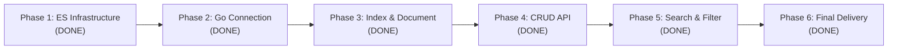

# Roadmap — go-elasticsearch-poc

Roadmap ini ditulis berdasarkan **evidence nyata**, bukan asumsi.
Tiap phase dilengkapi objective, deliverable, definition of done, dan bukti verifikasi runtime.

**Terakhir diperbarui:** 2026-10-29 (Phase 6 — Final Engineering Audit & POC Handoff selesai dan terbukti).

## Legenda status

| Status | Arti |
|---|---|
| DONE | Sudah dibuktikan dengan output runtime dan test otomatis |
| IN PROGRESS | Sedang dikerjakan |
| BLOCKED | Terhambat oleh dependensi atau kendala teknis |
| NOT IMPLEMENTED | Belum dikerjakan |

## Ringkasan Progres



| Phase | Status | Bukti Singkat |
|---|---|---|
| 1 — Elasticsearch Infrastructure | DONE | Docker Compose ES 9.5.5, single-node, cluster green, persistence volume |
| 2 — Go Connection | DONE | Official Typed Client v9.5.2, `client.Info()` return 9.5.5, error path teruji |
| 3 — Index & Document | DONE | Index `motorcycles` (1 shard, 0 replica, strict mapping), sample Honda BeAT tersimpan & terbaca, idempotent |
| 4 — CRUD API | DONE | REST API lengkap (POST, GET, PUT, DELETE, health), Go 1.22+ routing, optimistic locking, 100% test pass |
| 5 — Elasticsearch Search | DONE | Endpoint `GET /motorcycles` multi_match full-text, bool filtering, sorting, pagination, max_result_window guard, 100% pass |
| 6 — Final POC Delivery | DONE | Final audit, zero data race, E2E CRUD & search runtime verification, DEMO_GUIDE.md & API.md siap handoff |

---

## Phase 1 — Elasticsearch Infrastructure

**Objective:** Menyediakan instance Elasticsearch lokal yang stabil, persisten, dan mudah dijalankan via Docker Compose.

**Scope:**
- Docker Compose Elasticsearch `9.5.5`.
- Single-node cluster (`discovery.type=single-node`).
- Security dinonaktifkan khusus untuk local POC (`xpack.security.enabled=false`).
- Named volume `elasticsearch_data` untuk persistensi data.
- Healthcheck otomatis.
- Makefile shortcut (`make up`, `make down`, `make ps`, `make health`, `make logs`).

**Deliverables:**
- `compose.yml`
- `Makefile`
- `.gitignore`

**Definition of Done:**
- [x] Container berjalan dengan status `healthy`.
- [x] Cluster name `docker-cluster` dengan status `green`.
- [x] Node berjumlah 1.
- [x] Response `curl http://localhost:9200` mengembalikan version `9.5.5`.

**Evidence:**
- Container: `go-elasticsearch-poc-es` (Up, healthy).
- Cluster health: `{"status":"green","number_of_nodes":1,"active_shards":3,"unassigned_shards":0}`.

---

## Phase 2 — Go Connection

**Objective:** Menghubungkan program Go ke Elasticsearch menggunakan official Typed Client v9 dan membaca informasi cluster dengan aman.

**Scope:**
- Go module (`go 1.27.0`).
- Dependency `github.com/elastic/go-elasticsearch/v9 v9.5.2`.
- Konfigurasi environment (`ELASTICSEARCH_URL`).
- Client initialization dengan lifecycle closure `defer client.Close(ctx)`.
- Request `client.Info().Do(ctx)` dengan timeout 10 detik.
- Error wrapping idiomatic Go.

**Deliverables:**
- `go.mod`, `go.sum`
- `internal/config/config.go`
- `internal/repository/elastic/client.go`
- `cmd/api/main.go`

**Definition of Done:**
- [x] `go build ./...` dan `go vet ./...` exit 0.
- [x] Happy path menampilkan cluster name dan versi server.
- [x] Negative path (koneksi ditolak, URL kosong, timeout) tertangani dengan pesan error jelas.

**Evidence:**
- Output `make run` (`go run ./cmd/api`):
  ```text
  Elasticsearch connected
  Cluster : docker-cluster
  Version : 9.5.5
  ```

---

## Phase 3 — Index & Document (Honda Motorcycle)

**Objective:** Membuat index Elasticsearch bernama `motorcycles` dengan explicit mapping strict, menyimpan sample dokumen motor Honda, membaca dokumen secara real-time berdasarkan `_id`, dan memastikan operasi bersifat idempotent.

**Scope:**
- Index `motorcycles` dengan settings: `number_of_shards: 1`, `number_of_replicas: 0`.
- Explicit mapping:
  - `brand`: keyword
  - `model_name`: text + multi-field keyword (`model_name.keyword`)
  - `category`: keyword
  - `engine_cc`: integer
  - `transmission`: keyword
  - `price_idr`: long
  - `available`: boolean
  - `description`: text
  - `dynamic`: strict (menolak field liar yang tidak terdaftar)
- Model domain `model.Motorcycle` di `internal/model/motorcycle.go`.
- Operasi Typed Client di `internal/repository/elastic/motorcycle.go`:
  - `EnsureIndex`: membuat index jika belum ada, memverifikasi mapping jika sudah ada.
  - `Create`: menyimpan dokumen baru dengan proteksi conflict jika ID sudah ada.
  - `Get`: membaca dokumen berdasarkan `_id` secara real-time via `_source`.
- Demo runner di `cmd/demo/main.go` (`make demo`).
- Unit test murni di `config_test.go` dan `motorcycle_test.go`.

**Deliverables:**
- `internal/model/motorcycle.go`
- `internal/repository/elastic/motorcycle.go`
- `internal/repository/elastic/motorcycle_test.go`
- `internal/config/config.go` (dengan validasi index)
- `internal/config/config_test.go`
- `cmd/demo/main.go`
- `Makefile` (target `demo`)
- `.env.example`

**Definition of Done:**
- [x] `go test -v ./...` PASS untuk semua unit test.
- [x] `gofmt -l .` bersih tanpa format issue.
- [x] `go vet ./...` dan `go build ./...` exit 0.
- [x] Run 1 `make demo`: index `motorcycles` terbentuk, dokumen `honda-beat-001` tersimpan dan berhasil di-GET.
- [x] Run 2 `make demo`: index dan dokumen tidak diduplikasi atau di-overwrite (idempotent).
- [x] Verifikasi manual via `curl` memastikan mapping dan isi dokumen sesuai spesifikasi.

**Evidence (2026-10-29):**
1. Test output:
   ```text
   PASS: internal/config (TestLoad with 14 cases)
   PASS: internal/repository/elastic (TestMotorcycleMapping, TestMappingProblems, TestHasErrorType)
   ```
2. Run 1 demo:
   ```text
   Elasticsearch connected
   Cluster : docker-cluster
   Version : 9.5.5

   Index  : motorcycles
   Status : created (1 shard, 0 replicas, explicit mapping)

   Motorcycle saved
   ID     : honda-beat-001
   Model  : Honda BeAT

   Motorcycle fetched successfully (GET by ID)
   Brand        : Honda
   Model        : BeAT
   Category     : matic
   Engine (cc)  : 110
   Transmission : automatic
   Price (IDR)  : 19000000
   Available    : true
   Check        : stored document matches the sample
   ```
3. Run 2 demo (idempotency check):
   ```text
   Index  : motorcycles
   Status : already exists, mapping verified

   Motorcycle already exists, left unchanged
   ID     : honda-beat-001
   Model  : Honda BeAT

   Motorcycle fetched successfully (GET by ID)
   ...
   Check  : stored document matches the sample
   ```
4. Verifikasi `curl http://localhost:9200/_cat/indices?v`:
   ```text
   health status index       pri rep docs.count store.size
   green  open   motorcycles   1   0          1        8kb
   ```
5. Verifikasi `curl http://localhost:9200/motorcycles/_doc/honda-beat-001`:
   - `found: true`
   - `_source` memuat seluruh field Honda BeAT dengan tipe data yang tepat.

---

## Phase 4 — CRUD API (Motorcycle REST API)

**Objective:** Membangun RESTful HTTP API untuk operasi Create, Read, Replace (Update), dan Delete data motor Honda di Elasticsearch menggunakan Go standard library `net/http` dan official Typed Client v9.

**Scope:**
- HTTP handlers (`internal/handler/motorcycle.go`).
- Domain business validation service (`internal/service/motorcycle.go`).
- Repository extensions (`Replace` dengan optimistic concurrency control, `Delete`, `IsUnavailable` check).
- Standard library routing pattern modern Go 1.22+ (`POST /motorcycles`, `GET /motorcycles/{id}`, `PUT /motorcycles/{id}`, `DELETE /motorcycles/{id}`, `GET /health`).
- Path parameter reading via `r.PathValue("id")`.
- Strict JSON decoder (`DisallowUnknownFields()`, 1 MiB body limit, reject trailing objects).
- Error mapping ke HTTP status code: 201 Created, 200 OK, 204 No Content, 400 Bad Request, 404 Not Found, 409 Conflict, 503 Service Unavailable, 500 Internal Server Error.
- Graceful shutdown dengan signal trapping (SIGINT, SIGTERM) dan timeouts pada `http.Server`.
- Standard library `log/slog` untuk internal error logging tanpa membocorkan internal datastore ke client.
- Entrypoint HTTP server di `cmd/api/main.go` yang dijalankan via `make run`.
- Konfigurasi `HTTP_ADDR` (default `127.0.0.1:8080`).

**Deliverables:**
- `internal/handler/motorcycle.go`
- `internal/handler/motorcycle_test.go`
- `internal/service/motorcycle.go`
- `internal/service/motorcycle_test.go`
- `internal/repository/elastic/motorcycle.go` (ditambahkan method `Replace`, `Delete`, `IsUnavailable`)
- `internal/config/config.go` (ditambahkan field `HTTPAddr`)
- `internal/config/config_test.go`
- `cmd/api/main.go` (diubah menjadi REST API server)
- `.env.example`

**Definition of Done:**
- [x] `go test -v ./...` PASS 100% untuk semua package (`config`, `service`, `handler`, `repository/elastic`).
- [x] `gofmt -l .` bersih, `go vet ./...` dan `go build ./...` exit 0.
- [x] Server start listening on `127.0.0.1:8080`.
- [x] `GET /health` return 200 `{"status":"ok"}`.
- [x] `POST /motorcycles` membuat motor baru (201 Created).
- [x] `POST /motorcycles` dengan duplicate ID ditolak (409 Conflict).
- [x] `GET /motorcycles/{id}` mengembalikan data motor (200 OK).
- [x] `PUT /motorcycles/{id}` melakukan full replacement dengan sequence number verification (200 OK).
- [x] `PUT /motorcycles/{id}` pada ID yang tidak ada mengembalikan 404 Not Found (mencegah upsert diam-diam).
- [x] `DELETE /motorcycles/{id}` menghapus motor (204 No Content).
- [x] `GET /motorcycles/{id}` setelah dihapus mengembalikan 404 Not Found.
- [x] Format JSON salah atau field brand bukan Honda ditolak (400 Bad Request).
- [x] Dokumen Phase 3 `honda-beat-001` dan perintah `make demo` tetap utuh dan berfungsi normal.

**Evidence (2026-10-29):**
1. Test output:
   ```text
   PASS: internal/config (TestLoad with 15 test cases)
   PASS: internal/service (TestValidateID, TestValidateMotorcycle, TestServiceCRUDOperations)
   PASS: internal/handler (TestHandlerHealth, TestHandlerCreate [7 subtests], TestHandlerGet [3 subtests], TestHandlerReplace [4 subtests], TestHandlerDelete [2 subtests], TestWriteError, TestHandlerUnexpectedInternalError)
   PASS: internal/repository/elastic (TestMotorcycleMapping, TestMappingProblems, TestHasErrorType)
   ```
2. Manual curl test suite:
   ```text
   GET /health                            -> 200 OK ({"status":"ok"})
   POST /motorcycles (honda-scoopy-api-001)-> 201 Created
   GET /motorcycles/honda-scoopy-api-001  -> 200 OK (price_idr: 22000000)
   POST duplicate honda-scoopy-api-001    -> 409 Conflict ({"error":"motorcycle already exists"})
   PUT /motorcycles/honda-scoopy-api-001  -> 200 OK (price_idr updated to 23500000)
   GET after PUT                          -> 200 OK (price_idr: 23500000 verified)
   DELETE /motorcycles/honda-scoopy-api-001-> 204 No Content
   GET after DELETE                       -> 404 Not Found ({"error":"motorcycle not found"})
   PUT non-existent ID                    -> 404 Not Found (no upsert)
   POST invalid JSON format               -> 400 Bad Request
   POST invalid brand "Yamaha"            -> 400 Bad Request ({"error":"brand must be \"Honda\""})
   GET honda-beat-001 (Phase 3 doc)       -> 200 OK (data aman dan utuh)
   ```
3. Phase 3 Demo verification:
   `make demo` berhasil membaca `honda-beat-001` dengan idempotency verification utuh.

---

## Phase 5 — Elasticsearch Search, Filtering, Sorting & Pagination (DONE)

**Objective:** Mengimplementasikan endpoint pencarian tingkat lanjut (`GET /motorcycles`) yang mengeksploitasi fitur inti Elasticsearch: full-text search, bool query filtering, multi-field keyword sorting, dan pagination yang aman dari deep pagination crash.

**Scope:**
- Endpoint `GET /motorcycles` dengan query parameters: `search`, `category`, `transmission`, `available`, `min_price`, `max_price`, `sort`, `page`, `limit`.
- Full-text multi-field search menggunakan `multi_match` dengan field boost (`model_name^2`, `description`).
- Structured filtering menggunakan `bool.filter` (`term` queries untuk `category`, `transmission`, `available`, dan `range` query untuk `price_idr`).
- Sorting multi-field: `relevance` (`_score`), `price_asc`, `price_desc`, `name_asc` (`model_name.keyword`), `name_desc` (`model_name.keyword`).
- Safe pagination menggunakan `from` dan `size` dengan proteksi guard batas `from + size <= max_result_window` (10,000) dan batas limit 1–50 (default 10, default page 1).
- JSON Response contract: `{"data": [...], "pagination": {"page": 1, "limit": 10, "total": 1, "total_pages": 1}}`. Jika hasil kosong, `data` di-serialize sebagai `[]` (bukan `null`).
- Disambiguasi rute `GET /motorcycles` vs `GET /motorcycles/{id}` tanpa collision.

**Deliverables:**
- `internal/model/motorcycle.go`: Definisi `MotorcycleWithID`, `SearchFilter`, `SearchResult`.
- `internal/repository/elastic/motorcycle_search.go`: Query builder dengan `esdsl`, execution typed client, `TrackTotalHits`, decoder `_id` & `_source`.
- `internal/repository/elastic/motorcycle_search_test.go`: Unit tests serializer query builder dan sort options menggunakan `.QueryCaster()` dan `.SortCombinationsCaster()`.
- `internal/service/motorcycle.go`: Validasi bisnis search (`ValidateSearchFilter`), sanitasi string, penentuan default sort berdasar konteks pencarian, dan proteksi pagination.
- `internal/service/motorcycle_test.go`: Unit tests validasi parameter pencarian dan batas window.
- `internal/handler/motorcycle.go`: HTTP handler `List`, parser query parameter, formatter payload JSON.
- `internal/handler/motorcycle_test.go`: Mocked httptest covering status 200, 400, 503, empty slice, and route disambiguation.

**Definition of Done Checklist:**
- [x] Endpoint `GET /motorcycles` terdaftar dan dapat diakses tanpa tabrakan dengan `GET /motorcycles/{id}`.
- [x] Full-text search `search` mencari di `model_name^2` (boosted) dan `description`.
- [x] Filter exact term pada `category`, `transmission`, dan boolean `available`.
- [x] Filter rentang numerik `min_price` dan `max_price` pada `price_idr`.
- [x] Sorting bekerja untuk `relevance`, `price_asc`, `price_desc`, `name_asc`, dan `name_desc`. Sorting nama menggunakan `model_name.keyword`.
- [x] Default sort: `relevance` jika ada parameter `search`, `name_asc` jika `search` kosong.
- [x] Parameter `sort=relevance` ditolak (400 Bad Request) jika tidak ada kata kunci pencarian.
- [x] Pagination valid: page >= 1 (default 1), limit 1–50 (default 10).
- [x] Deep pagination guard: jika `(page-1)*limit + limit > 10000`, API mengembalikan 400 Bad Request.
- [x] Response JSON mengembalikan `"data": []` (non-nil empty array) jika tidak ada data yang cocok.
- [x] `go test -v ./...` dan `go vet ./...` exit 0 (100% pass).
- [x] Runtime verification pada cluster Elasticsearch lokal terbukti sukses dengan data fixtures dan sample `honda-beat-001` tetap utuh.
- [x] `make demo` tetap berjalan sukses dan idempotent.

**Bukti Verifikasi Runtime:**
1. Automated unit test suite:
   ```text
   PASS: TestBuildSearchQuery (4 subtests)
   PASS: TestBuildSortOption (6 subtests)
   PASS: TestValidateSearchFilter (14 subtests)
   PASS: TestServiceSearchOperation (2 subtests)
   PASS: TestHandlerListMotorcycles (18 subtests)
   ok  	github.com/fajri-rabka/go-elasticsearch-poc/internal/config	(cached)
   ok  	github.com/fajri-rabka/go-elasticsearch-poc/internal/handler	0.008s
   ok  	github.com/fajri-rabka/go-elasticsearch-poc/internal/repository/elastic	0.011s
   ok  	github.com/fajri-rabka/go-elasticsearch-poc/internal/service	0.005s
   ```
2. Runtime curl integration verification:
   ```text
   GET /motorcycles                                      -> 200 OK (4 items sorted by name asc, total: 4, pages: 1)
   GET /motorcycles?search=BeAT                          -> 200 OK (1 item matched BeAT, score-based relevance)
   GET /motorcycles?category=matic                       -> 200 OK (2 items: BeAT & Vario 160)
   GET /motorcycles?sort=price_desc&page=1&limit=2       -> 200 OK (2 items: CBR250RR 75M, CB150R 31M, total_pages: 2)
   GET /motorcycles?sort=price_desc&page=2&limit=2       -> 200 OK (2 items: Vario 160 28M, BeAT 19M)
   GET /motorcycles?available=false                      -> 200 OK (1 item: Vario 160)
   GET /motorcycles?min_price=15000000&max_price=30000000 -> 200 OK (2 items: BeAT 19M & Vario 160 28M)
   GET /motorcycles?search=nonexistentterm               -> 200 OK ("data": [], total: 0, total_pages: 0)
   GET /motorcycles?page=0                               -> 400 Bad Request ("page must be greater than or equal to 1")
   GET /motorcycles?limit=0                              -> 400 Bad Request ("limit must be between 1 and 50")
   GET /motorcycles?limit=51                             -> 400 Bad Request ("limit must be between 1 and 50")
   GET /motorcycles?min_price=20000000&max_price=10000000 -> 400 Bad Request ("min_price cannot be greater than max_price")
   GET /motorcycles?sort=invalid                         -> 400 Bad Request ("invalid sort option \"invalid\"")
   GET /motorcycles?sort=relevance                       -> 400 Bad Request ("sort=relevance is only valid when a search query is provided")
   GET /motorcycles?page=1001&limit=10                   -> 400 Bad Request ("page offset and limit exceed maximum result window of 10000")
   GET /motorcycles/honda-beat-001                       -> 200 OK (route disambiguation confirmed, existing doc intact)
   ```
3. Phase 3 Demo verification:
   `make demo` berhasil membaca `honda-beat-001` dengan idempotency verification utuh.

---

## Phase 6 — Final Engineering Audit & POC Handoff (DONE)

**Objective:** Audit menyeluruh terhadap kualitas kode, kebenaran implementasi Elasticsearch, keamanan lingkungan lokal, kestabilan runtime, penyiapan panduan demo 5-10 menit untuk Koh Franz, dan final handoff readiness assessment.

**Scope:**
- Repository and code audit: Handler, Service, Repository, Config, Tests.
- Evaluasi semantik CRUD, Optimistic Concurrency Control, dan Search DSL.
- Security review: Exposure port Docker 9200, input safety, error masking.
- Resource & environment review: RAM, Swap, container stats, vmstat.
- Test suite verification: `gofmt`, `go vet`, `go test -count=1`, `go test -race`, statement coverage.
- End-to-End validation runtime menggunakan dummy fixture ID terpisah (`honda-adv-audit-001`).
- Penulisan panduan serah terima demo: [docs/DEMO_GUIDE.md](DEMO_GUIDE.md) dan spesifikasi REST API: [docs/API.md](API.md).
- Dokumentasi trade-off arsitektural: Elasticsearch vs PostgreSQL.

**Definition of Done Checklist:**
- [x] Read-only discovery dan audit arsitektur codebase selesai tanpa refactor berlebihan.
- [x] `go test -race -count=1 ./...` exit 0 tanpa data race sama sekali.
- [x] `go vet ./...` dan `gofmt -l .` exit 0.
- [x] Statement coverage terukur: Config (96.9%), Service (93.4%), Handler (87.3%), Repository (40.6%).
- [x] E2E runtime verification pada cluster lokal terbukti sukses untuk seluruh endpoint (Health, CRUD, Search, Filter, Sort, Pagination, Error Handling).
- [x] Dokumen sampel Phase 3 `honda-beat-001` terbukti aman, utuh, dan `make demo` tetap sukses.
- [x] Temuan keamanan (Docker port `9200:9200` vs `127.0.0.1:9200:9200`) dan module naming mismatch terdokumentasi jelas.
- [x] Dokumen `docs/DEMO_GUIDE.md` dan `docs/API.md` selesai dan siap dipakai untuk demo ke Koh Franz.
- [x] Dokumen `docs/LEARNING_GUIDE.md` disempurnakan tanpa klaim menyesatkan (*misleading statements*).
- [x] Status handoff ditentukan: **READY WITH LIMITATIONS** (siap demo dan handoff dengan batasan local POC yang tercatat).


