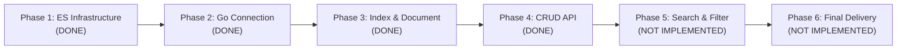

# Roadmap — go-elasticsearch-poc

Roadmap ini ditulis berdasarkan **evidence nyata**, bukan asumsi.
Tiap phase dilengkapi objective, deliverable, definition of done, dan bukti verifikasi runtime.

**Terakhir diperbarui:** 2026-10-29 (Phase 4 — Motorcycle REST API CRUD selesai dan terbukti).

## Legenda status

| Status | Arti |
|---|---|
| DONE | Sudah dibuktikan dengan output runtime dan test otomatis |
| IN PROGRESS | Sedang dikerjakan |
| BLOCKED | Terhambat oleh dependensi atau kendala teknis |
| NOT IMPLEMENTED | Belum dikerjakan |

## Ringkasan Progres



| Phase | Status | Bukti Singkat |
|---|---|---|
| 1 — Elasticsearch Infrastructure | DONE | Docker Compose ES 9.5.5, single-node, cluster green, persistence volume |
| 2 — Go Connection | DONE | Official Typed Client v9.5.2, `client.Info()` return 9.5.5, error path teruji |
| 3 — Index & Document | DONE | Index `motorcycles` (1 shard, 0 replica, strict mapping), sample Honda BeAT tersimpan & terbaca, idempotent |
| 4 — CRUD API | DONE | REST API lengkap (POST, GET, PUT, DELETE, health), Go 1.22+ routing, optimistic locking, 100% test pass |
| 5 — Elasticsearch Search | NOT IMPLEMENTED | Direncanakan (full-text search, filter, multi-field, pagination) |
| 6 — Final POC Delivery | NOT IMPLEMENTED | Direncanakan (final review, demo handoff ke Koh Franz) |

---

## Phase 1 — Elasticsearch Infrastructure

**Objective:** Menyediakan instance Elasticsearch lokal yang stabil, persisten, dan mudah dijalankan via Docker Compose.

**Scope:**
- Docker Compose Elasticsearch `9.5.5`.
- Single-node cluster (`discovery.type=single-node`).
- Security dinonaktifkan khusus untuk local POC (`xpack.security.enabled=false`).
- Named volume `elasticsearch_data` untuk persistensi data.
- Healthcheck otomatis.
- Makefile shortcut (`make up`, `make down`, `make ps`, `make health`, `make logs`).

**Deliverables:**
- `compose.yml`
- `Makefile`
- `.gitignore`

**Definition of Done:**
- [x] Container berjalan dengan status `healthy`.
- [x] Cluster name `docker-cluster` dengan status `green`.
- [x] Node berjumlah 1.
- [x] Response `curl http://localhost:9200` mengembalikan version `9.5.5`.

**Evidence:**
- Container: `go-elasticsearch-poc-es` (Up, healthy).
- Cluster health: `{"status":"green","number_of_nodes":1,"active_shards":3,"unassigned_shards":0}`.

---

## Phase 2 — Go Connection

**Objective:** Menghubungkan program Go ke Elasticsearch menggunakan official Typed Client v9 dan membaca informasi cluster dengan aman.

**Scope:**
- Go module (`go 1.27.0`).
- Dependency `github.com/elastic/go-elasticsearch/v9 v9.5.2`.
- Konfigurasi environment (`ELASTICSEARCH_URL`).
- Client initialization dengan lifecycle closure `defer client.Close(ctx)`.
- Request `client.Info().Do(ctx)` dengan timeout 10 detik.
- Error wrapping idiomatic Go.

**Deliverables:**
- `go.mod`, `go.sum`
- `internal/config/config.go`
- `internal/repository/elastic/client.go`
- `cmd/api/main.go`

**Definition of Done:**
- [x] `go build ./...` dan `go vet ./...` exit 0.
- [x] Happy path menampilkan cluster name dan versi server.
- [x] Negative path (koneksi ditolak, URL kosong, timeout) tertangani dengan pesan error jelas.

**Evidence:**
- Output `make run` (`go run ./cmd/api`):
  ```text
  Elasticsearch connected
  Cluster : docker-cluster
  Version : 9.5.5
  ```

---

## Phase 3 — Index & Document (Honda Motorcycle)

**Objective:** Membuat index Elasticsearch bernama `motorcycles` dengan explicit mapping strict, menyimpan sample dokumen motor Honda, membaca dokumen secara real-time berdasarkan `_id`, dan memastikan operasi bersifat idempotent.

**Scope:**
- Index `motorcycles` dengan settings: `number_of_shards: 1`, `number_of_replicas: 0`.
- Explicit mapping:
  - `brand`: keyword
  - `model_name`: text + multi-field keyword (`model_name.keyword`)
  - `category`: keyword
  - `engine_cc`: integer
  - `transmission`: keyword
  - `price_idr`: long
  - `available`: boolean
  - `description`: text
  - `dynamic`: strict (menolak field liar yang tidak terdaftar)
- Model domain `model.Motorcycle` di `internal/model/motorcycle.go`.
- Operasi Typed Client di `internal/repository/elastic/motorcycle.go`:
  - `EnsureIndex`: membuat index jika belum ada, memverifikasi mapping jika sudah ada.
  - `Create`: menyimpan dokumen baru dengan proteksi conflict jika ID sudah ada.
  - `Get`: membaca dokumen berdasarkan `_id` secara real-time via `_source`.
- Demo runner di `cmd/demo/main.go` (`make demo`).
- Unit test murni di `config_test.go` dan `motorcycle_test.go`.

**Deliverables:**
- `internal/model/motorcycle.go`
- `internal/repository/elastic/motorcycle.go`
- `internal/repository/elastic/motorcycle_test.go`
- `internal/config/config.go` (dengan validasi index)
- `internal/config/config_test.go`
- `cmd/demo/main.go`
- `Makefile` (target `demo`)
- `.env.example`

**Definition of Done:**
- [x] `go test -v ./...` PASS untuk semua unit test.
- [x] `gofmt -l .` bersih tanpa format issue.
- [x] `go vet ./...` dan `go build ./...` exit 0.
- [x] Run 1 `make demo`: index `motorcycles` terbentuk, dokumen `honda-beat-001` tersimpan dan berhasil di-GET.
- [x] Run 2 `make demo`: index dan dokumen tidak diduplikasi atau di-overwrite (idempotent).
- [x] Verifikasi manual via `curl` memastikan mapping dan isi dokumen sesuai spesifikasi.

**Evidence (2026-10-29):**
1. Test output:
   ```text
   PASS: internal/config (TestLoad with 14 cases)
   PASS: internal/repository/elastic (TestMotorcycleMapping, TestMappingProblems, TestHasErrorType)
   ```
2. Run 1 demo:
   ```text
   Elasticsearch connected
   Cluster : docker-cluster
   Version : 9.5.5

   Index  : motorcycles
   Status : created (1 shard, 0 replicas, explicit mapping)

   Motorcycle saved
   ID     : honda-beat-001
   Model  : Honda BeAT

   Motorcycle fetched successfully (GET by ID)
   Brand        : Honda
   Model        : BeAT
   Category     : matic
   Engine (cc)  : 110
   Transmission : automatic
   Price (IDR)  : 19000000
   Available    : true
   Check        : stored document matches the sample
   ```
3. Run 2 demo (idempotency check):
   ```text
   Index  : motorcycles
   Status : already exists, mapping verified

   Motorcycle already exists, left unchanged
   ID     : honda-beat-001
   Model  : Honda BeAT

   Motorcycle fetched successfully (GET by ID)
   ...
   Check  : stored document matches the sample
   ```
4. Verifikasi `curl http://localhost:9200/_cat/indices?v`:
   ```text
   health status index       pri rep docs.count store.size
   green  open   motorcycles   1   0          1        8kb
   ```
5. Verifikasi `curl http://localhost:9200/motorcycles/_doc/honda-beat-001`:
   - `found: true`
   - `_source` memuat seluruh field Honda BeAT dengan tipe data yang tepat.

---

## Phase 4 — CRUD API (Motorcycle REST API)

**Objective:** Membangun RESTful HTTP API untuk operasi Create, Read, Replace (Update), dan Delete data motor Honda di Elasticsearch menggunakan Go standard library `net/http` dan official Typed Client v9.

**Scope:**
- HTTP handlers (`internal/handler/motorcycle.go`).
- Domain business validation service (`internal/service/motorcycle.go`).
- Repository extensions (`Replace` dengan optimistic concurrency control, `Delete`, `IsUnavailable` check).
- Standard library routing pattern modern Go 1.22+ (`POST /motorcycles`, `GET /motorcycles/{id}`, `PUT /motorcycles/{id}`, `DELETE /motorcycles/{id}`, `GET /health`).
- Path parameter reading via `r.PathValue("id")`.
- Strict JSON decoder (`DisallowUnknownFields()`, 1 MiB body limit, reject trailing objects).
- Error mapping ke HTTP status code: 201 Created, 200 OK, 204 No Content, 400 Bad Request, 404 Not Found, 409 Conflict, 503 Service Unavailable, 500 Internal Server Error.
- Graceful shutdown dengan signal trapping (SIGINT, SIGTERM) dan timeouts pada `http.Server`.
- Standard library `log/slog` untuk internal error logging tanpa membocorkan internal datastore ke client.
- Entrypoint HTTP server di `cmd/api/main.go` yang dijalankan via `make run`.
- Konfigurasi `HTTP_ADDR` (default `127.0.0.1:8080`).

**Deliverables:**
- `internal/handler/motorcycle.go`
- `internal/handler/motorcycle_test.go`
- `internal/service/motorcycle.go`
- `internal/service/motorcycle_test.go`
- `internal/repository/elastic/motorcycle.go` (ditambahkan method `Replace`, `Delete`, `IsUnavailable`)
- `internal/config/config.go` (ditambahkan field `HTTPAddr`)
- `internal/config/config_test.go`
- `cmd/api/main.go` (diubah menjadi REST API server)
- `.env.example`

**Definition of Done:**
- [x] `go test -v ./...` PASS 100% untuk semua package (`config`, `service`, `handler`, `repository/elastic`).
- [x] `gofmt -l .` bersih, `go vet ./...` dan `go build ./...` exit 0.
- [x] Server start listening on `127.0.0.1:8080`.
- [x] `GET /health` return 200 `{"status":"ok"}`.
- [x] `POST /motorcycles` membuat motor baru (201 Created).
- [x] `POST /motorcycles` dengan duplicate ID ditolak (409 Conflict).
- [x] `GET /motorcycles/{id}` mengembalikan data motor (200 OK).
- [x] `PUT /motorcycles/{id}` melakukan full replacement dengan sequence number verification (200 OK).
- [x] `PUT /motorcycles/{id}` pada ID yang tidak ada mengembalikan 404 Not Found (mencegah upsert diam-diam).
- [x] `DELETE /motorcycles/{id}` menghapus motor (204 No Content).
- [x] `GET /motorcycles/{id}` setelah dihapus mengembalikan 404 Not Found.
- [x] Format JSON salah atau field brand bukan Honda ditolak (400 Bad Request).
- [x] Dokumen Phase 3 `honda-beat-001` dan perintah `make demo` tetap utuh dan berfungsi normal.

**Evidence (2026-10-29):**
1. Test output:
   ```text
   PASS: internal/config (TestLoad with 15 test cases)
   PASS: internal/service (TestValidateID, TestValidateMotorcycle, TestServiceCRUDOperations)
   PASS: internal/handler (TestHandlerHealth, TestHandlerCreate [7 subtests], TestHandlerGet [3 subtests], TestHandlerReplace [4 subtests], TestHandlerDelete [2 subtests], TestWriteError, TestHandlerUnexpectedInternalError)
   PASS: internal/repository/elastic (TestMotorcycleMapping, TestMappingProblems, TestHasErrorType)
   ```
2. Manual curl test suite:
   ```text
   GET /health                            -> 200 OK ({"status":"ok"})
   POST /motorcycles (honda-scoopy-api-001)-> 201 Created
   GET /motorcycles/honda-scoopy-api-001  -> 200 OK (price_idr: 22000000)
   POST duplicate honda-scoopy-api-001    -> 409 Conflict ({"error":"motorcycle already exists"})
   PUT /motorcycles/honda-scoopy-api-001  -> 200 OK (price_idr updated to 23500000)
   GET after PUT                          -> 200 OK (price_idr: 23500000 verified)
   DELETE /motorcycles/honda-scoopy-api-001-> 204 No Content
   GET after DELETE                       -> 404 Not Found ({"error":"motorcycle not found"})
   PUT non-existent ID                    -> 404 Not Found (no upsert)
   POST invalid JSON format               -> 400 Bad Request
   POST invalid brand "Yamaha"            -> 400 Bad Request ({"error":"brand must be \"Honda\""})
   GET honda-beat-001 (Phase 3 doc)       -> 200 OK (data aman dan utuh)
   ```
3. Phase 3 Demo verification:
   `make demo` berhasil membaca `honda-beat-001` dengan idempotency verification utuh.

---

## Phase 5 — Elasticsearch Search & Filter (Upcoming)

**Objective:** Mengeksplorasi kemampuan utama Elasticsearch untuk full-text search, filtering, dan sorting pada katalog motor.

**Scope:**
- Full-text search pada `description` dan `model_name`.
- Filter exact match pada `brand`, `category`, `transmission`.
- Range filter pada `price_idr` dan `engine_cc`.
- Sorting berdasarkan harga atau nama model (menggunakan `model_name.keyword`).
- Pagination menggunakan `from` dan `size`.
- Penjelasan near-real-time (NRT) dan refresh behavior pada operasi pencarian.

**Dependencies:** Phase 4.

---

## Phase 6 — Final POC Delivery (Upcoming)

**Objective:** Penyelesaian akhir, dokumentasi lengkap, dan serah terima (handoff) ke Koh Franz.

**Scope:**
- Code cleanup dan final audit.
- Dokumentasi API (curl examples / collection).
- Demo scenario script.
- Final review arsitektur dan trade-offs penggunaan Elasticsearch sebagai primary datastore.

